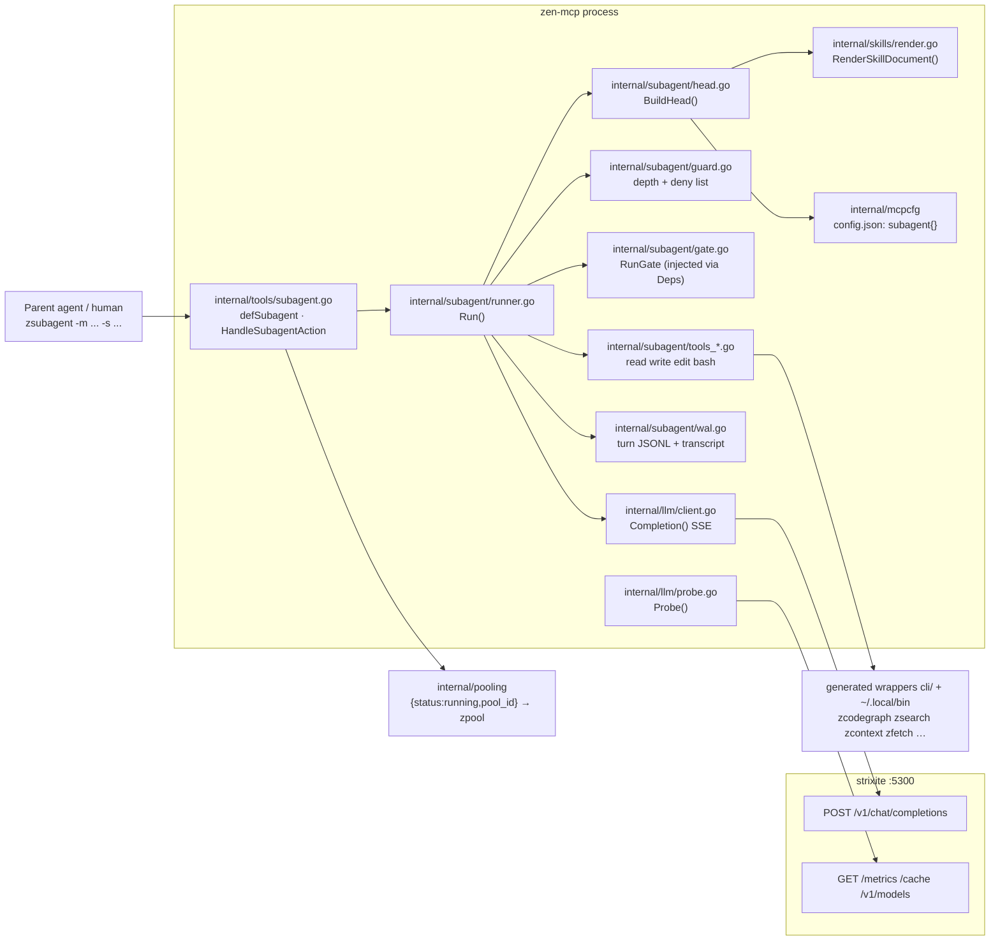
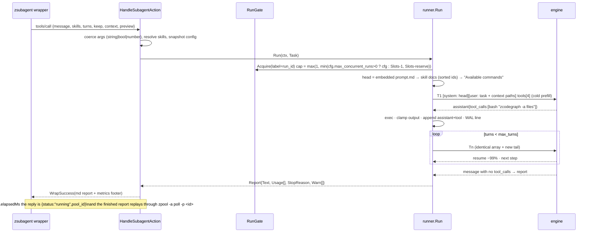

# ARCHITECTURE PLAN — `subagent` tool (`zsubagent`)

## 1. Summary

Add one tool to zen-mcp: a lean, self-contained agentic loop that talks to an OpenAI-compatible local
inference server (`strixite`) over HTTP directly, with **four native tools only** (`read`, `write`,
`edit`, `bash`) and **skills as the capability axis**. A skill injected with `-s` contributes its
`zskill -a get -i <id>` document plus a declared command manifest, so the subagent reaches the whole
MCP surface through the already-generated `z*` bash wrappers — CLI-shaped capability, MCP power, near
zero schema tax. Everything above the task text is byte-stable, so the engine resumes instead of
re-prefilling; runs append a write-ahead log every turn, can be resumed when kept, and long runs ride
the existing job pool. Motivating constraint, measured below: this engine caches **one conversation
state per slot**, so a client that changes nothing above the task and never mutates history is the
difference between a 200 ms turn and a 9 s turn.

Target CLI (`zexport_cli -s true`, aliases verified against the real generator):

```
zsubagent -m "explore package X for functions related to Y" -s explorer,codebase-research
```

## 2. Engine facts — measured, not assumed

Probes run against `http://192.168.1.233:5300` (build v0.4.x, `owned_by: strix-infer`), payloads in
§10. `GET /v1/models` → `qwen3.8-flash-next`, `context_length: 524288` (pi's `models.json` claims
262144 — **do not trust the client-side number**, `Probe()` wins).

| Fact | Evidence |
|---|---|
| OpenAI tool calling works; `finish_reason:"tool_calls"`, `arguments` as a JSON string | live probe |
| Multi-turn replay of `assistant{content:null,tool_calls:[…]}` + `role:"tool"` accepted, loop continues | live probe |
| Thinking **on by default**, arrives as `delta.reasoning_content`; `strix.thinking ∈ on/off/skipped`; knobs `reasoning_effort` / `max_thinking_tokens` / `thinking:{budget_tokens}` / `chat_template_kwargs`; conflicting *budgets* → 400 | docs + live probe (`xhigh` + `max_thinking_tokens` + `top_k/top_p/frequency_penalty` → 200) |
| Per-response cache telemetry: `usage.prompt_tokens_details.cached_tokens`, `timings{prompt_n,prompt_ms,cache_n,queue_ms,prompt_per_second}`, `strix{max_tokens_clamped,malformed_tool_calls,…}` | live probe |
| **Within-run append-only resume ≈ 99%**: 12.3k-token head + tools: T1 cached 0 (8952 ms) → T2 12352/12413 (212 ms) → T3 12408/12516 (276 ms) | live probe |
| Resume point is the **previous prompt's end** — generated tokens are never replayed, so per-turn prefill = newly appended tokens only | live probe (T2 resumed exactly T1's prompt length) |
| **v0.4 is single-snapshot: no partial resume, no cross-run head sharing.** `H+taskA` → `H+taskB` → `H+taskA` all `cached=0` (≈9 s each) | live probe §10 |
| Cache state is not TTL-bound (≥25 s idle still hits); it is *last-writer-wins* | live probe |
| Concurrent **identical** prefixes are serialised server-side: first prefills, others `queue_ms≈8 s` then hit → **no client-side warm gate needed** | live probe (4 concurrent) |
| `GET /metrics` (v0.4): `strix_busy`, `strix_queue_depth`, `strix_prompt_tokens_cached_total`; **no `strix_slots`** | live probe |
| `GET /cache`: `{hits,misses,prompt_tokens_saved,live_tokens,snapshot_pos,disk_hits,disk_tokens_saved}` → server-side proof for acceptance tests | live probe |
| `max_tokens` over-context is **clamped, not rejected** (`strix.max_tokens_clamped`) | live probe |

v0.5.0 (user recompiling) adds **multi-slot** `total-slots` (2 default, ≤8), one conversation per slot
at full context, batched decode, "a coding agent and its subagents … don't evict one another";
requests past slots wait in arrival order; `strix_busy` out of `strix_slots`. Prompt cache becomes a
two-tier RAM→disk store of conversations, **delta-saved per turn**, `prompt-cache-idle-s` 3600 s.
Their failure table is our spec: *"the client changed the start of the prompt — usually its tool
list … or a date in its system prompt"* → `resume lost 4,178 tokens … in message 1 of 45`. Also new:
`"return_progress": true` → `prompt_progress{total,cache,processed,time_ms}` `data:` chunks;
*"a one-shot request — a single message with no tools — is kept in RAM only and never written"*.

**[HYPOTHESIS, must be measured after the v0.5 upgrade]:** cross-run head sharing. Their log mentions a
separate `system-prefix entry (RAM)` compared token-by-token, which is the mechanism that would make a
shared head pay off across runs. It is **not** available on the build measured here, and no part of
this plan's acceptance depends on it (test T-L2 measures it post-upgrade).

## 3. Boundaries



Never touched: the Firefox bridge, `agentbridge.DelegateToWebAgent`, whiteboard, codegraph internals.
The subagent reaches those only the way a human does — through the `z*` wrappers from `bash`.

## 4. Data flow, head layout, and state



**Head contract (all of it cached; nothing below may move):**

```
messages[0] = { role: "system", content:
    <embedded base prompt.md>
    ++ "## Skills\n" ++ skill documents, sorted by id            (exact RenderSkillDocument bytes)
    ++ "## Available commands\n" ++ sorted union of skill `tools:` grants   ← LAST, so adding a
       skill with already-known grants does not shift earlier bytes          skill mutates the tail only
}
messages[1] = { role: "user", content: task text ++ "\n\nContext files (read them with `read`):\n- <path>" }
tools = [bash, edit, read, write]   ← sorted by name, fixed at run start, never per-turn or per-skill
```

Banned from the head: dates, clock, cwd, run id, session id, workspace path, `strix` diagnostics,
tool output. All of that is tail material or report material.

**State:** `[]llm.Message` per run (append-only, never edited, never compacted), a per-turn JSONL
write-ahead line, in-memory `RunGate` + cached `EngineInfo`, and the engine's own KV. No new database.

**WAL (`<transcripts_dir>/<run_id>.jsonl`), always written:** one line per event
`{t, turn, prompt, cached, prefill_ms, queue_ms, finish, args_bytes, head_fp}` plus, per turn, the
exact appended messages (`content` as `json.RawMessage` so `null` vs `""` survives round-trip) and,
when `keep`, `reasoning_content`. Record 0 stores the **exact head bytes**. Outcomes:
`keep:true` → file retained and resumable; `keep:false` + success → retained as `<run_id>.report.md`
only if the report exceeds `report_max_kb`, both deleted otherwise; **any non-success exit → WAL kept**
(diagnosis + the resume path after an engine restart).

## 5. Implementation blueprint

Ordering is the dependency order; the numbered build sequence is §9.

| # | File | Action | Concrete signature / schema | Depends on | Done when |
|---|---|---|---|---|---|
| 1 | `internal/mcpcfg/config.go` | modify | `type LLMProvider struct{ BaseURL, API, APIKey, APIKeyEnv, Model string; MaxTokens int }`; `type SubagentConfig struct{ Providers map[string]LLMProvider \`json:"providers"\`; DefaultProvider string \`json:"default_provider"\`; MaxTurns int \`json:"max_turns"\`; RequestTimeoutMs, RunTimeoutMs, QueueTimeoutMs int; MaxConcurrentRuns int \`json:"max_concurrent_runs"\`; SlotReserve int \`json:"slot_reserve"\`; ToolOutputMaxChars int \`json:"tool_output_max_chars"\`; ReportMaxKb int \`json:"report_max_kb"\`; TranscriptsDir, ScratchDir string; Sampling map[string]any \`json:"sampling"\` }`; `ZenConfig.Subagent SubagentConfig \`json:"subagent"\``; `func Subagent() SubagentConfig` applying defaults on read (`max_turns 24`, `request_timeout_ms 300000`, `run_timeout_ms 1500000`, `queue_timeout_ms 300000`, `slot_reserve 1`, `tool_output_max_chars 24000`, `report_max_kb 8`, `transcripts_dir ".zenmcp/subagent"`, `scratch_dir` → `os.TempDir()/zen-mcp/subagent`) | — | with the block absent, `Subagent()` returns those defaults; editing `max_turns` changes behaviour with no restart (`WatchConfig`) |
| 2 | `config.json` | modify | `"subagent": { "providers": { "local": { "base_url": "http://192.168.1.233:5300/v1", "api": "openai-completions", "api_key_env": "", "model": "qwen3.8-flash-next", "max_tokens": 128000 } }, "default_provider": "local", … }` + `"sampling": { "reasoning_effort": "xhigh", "max_thinking_tokens": 8192, "temperature": 0 }`; add `"subagent"` to `pooling.tools`; **no `context_window` key** (probe owns it); no plaintext key (`config.json` is git-tracked) | 1 | `zsubagent -p true` echoes the resolved block; `git diff` shows no secret values |
| 3 | `internal/llm/types.go` | create | `type Message struct{ Role string; Content json.RawMessage; ToolCalls []ToolCall \`json:",omitempty"\`; ToolCallID string \`json:"tool_call_id,omitempty"\` }` with `func TextMessage(role, text string) Message` and `MarshalJSON` emitting `content:null` when unset; `type ToolCall struct{ ID, Type string; Function FunctionCall }`; `type FunctionCall struct{ Name, Arguments string }`; `type ToolSpec struct{ Name, Description string; Parameters json.RawMessage }` with `func (t ToolSpec) MarshalJSON() ([]byte, error)` emitting `{"function":{…}}` with **keys in a fixed order**; `type Request struct{ Model string; Messages []Message; Tools []ToolSpec; Stream bool; MaxTokens int; ReturnProgress bool; Extra json.RawMessage }` (`Extra` = marshalled config `sampling`, merged last, `json.Marshal` of a map is key-sorted ⇒ deterministic); `type Response struct{ ID, Model string; Choices []Choice; Usage Usage; Timings Timings; Strix Strix }`; `type Choice struct{ Index int; Message Message; FinishReason string }`; `Usage{PromptTokens, CompletionTokens, TotalTokens int; PromptTokensDetails struct{CachedTokens int \`json:"cached_tokens"\`}}`; `Timings{PromptN, CacheN int; PromptMS, PredictedMS, QueueMS float64}`; `Strix{Thinking string; MaxTokensClamped bool; MalformedToolCalls int}`; `type Delta struct{ Role, Content, ReasoningContent string; ToolCalls []ToolCallChunk }` + `type ToolCallChunk struct{ Index int; ID, Type string; Function *FunctionDelta }` | 1 | `json.Marshal(Request)` is byte-identical across two runs with the same inputs; a golden file matches a real captured request |
| 4 | `internal/llm/client.go` | create | `type Client struct{ ... }`; `func New(p Provider, timeout time.Duration) *Client`; `func (c *Client) Completion(ctx context.Context, req *Request, onDelta func(Delta) error) (*Response, error)` — always `stream:true`, aggregates `delta.tool_calls` by `index` (`arguments` concatenated verbatim), captures the final usage/`timings`/`strix` chunk, honours `data: [DONE]`, tolerates `: prefill …` SSE comment lines; typed `ErrUnreachable{BaseURL}` and `ErrEngineStatus{Code int, Body string}` (body quoted verbatim — strixite names the offending keyword in 400s); `func (c *Client) Models(ctx) ([]ModelInfo, error)`; `recover()` guard around the reader | 3 | httptest: request bytes match golden; streamed reasoning+tool_calls+usage parses; a 400 body surfaces to the caller verbatim; unreachable host ⇒ `ErrUnreachable` naming the base URL |
| 5 | `internal/llm/probe.go` | create | `type EngineInfo struct{ Slots, ContextLength int; Version string }`; `func Probe(ctx context.Context, p Provider, hc *http.Client) (EngineInfo, error)` — `GET /v1/models` (`context_length`, `data[0].id`) + `GET /metrics` (`^strix_slots\s+(\d+)`, `^strix_version\s+(\S+)`); **absent `strix_slots` ⇒ `Slots = 1`**; unreachable ⇒ `EngineInfo{Slots:1}` + logged warning (never fatal); cached per base URL for 30 s | 3,4 | against the live v0.4 box `Slots==1, ContextLength==524288`; a fixture with `strix_slots 4` yields `4` |
| 6 | `internal/skills/render.go` | create | `func RenderSkillDocument(id string) (string, error)` — the `zskill -a get -i <id>` document: `# Skill: <title> (<id>)`, `*Framework: <f>*`, `## Knowledge Content`, body; `TransformMCPToCLI` applied **exactly once**, gated on `mcpcfg.Get().Mcp2Cli`; `## Referenced Files` rendered **workspace-relative** from `SkillBundlePaths` (below), skipping `.`/`_`-prefixed entries, sorted | — | same output as today for `grill-me` except paths are relative and hidden/`__pycache__` entries are gone; two runs ⇒ identical bytes |
| 7 | `internal/skills/reference_resolver.go` | modify | `func SkillBundlePaths(dir string) []string` (sorted, dot/underscore-prefixed skipped); `ParseFrontmatter`: list handling generalised from the hardcoded `triggers` branch to `triggers:` **and** `tools:`, accepting block **and** flow style (`tools: [a, b]`), and skipping empty items (kills the existing `["", "a"]` bug); `SkillRegistryEntry.ToolsList []string` | — | `tools: [zcodegraph, zsearch]` and the block form both parse to those two names; unmodified skills parse identically |
| 8 | `internal/tools/skills.go` | modify | `handleSkillsGet` → `doc, err := skills.RenderSkillDocument(id)`; delete the inline render + local transform call | 6 | `zskill -a get -i grill-me` unchanged apart from the relative-path section |
| 9 | `internal/subagent/prompt.md` + `prompt.go` | create | `//go:embed prompt.md` → `var BasePrompt string`. Contents (fixed): role ("you are a subagent, you have no MCP tools, everything is `sh` + the commands listed below"); tool contract (`read` line format, `edit` requires one exact match, `write` overwrites); workflow (plan → act → verify); report contract (**end with a prose/Markdown message that names no tool** — that message *is* the report); clamping notice ("full output of a clamped command is at the printed path — `read` it"); rules against `rm -rf`, force-push, and touching files outside the task. **No date/cwd/run-id placeholders** | — | `BasePrompt != ""`; test greps it for `{{`, `time.Now`, and any absolute path |
| 10 | `internal/subagent/head.go` | create | `type HeadSpec struct{ SkillIDs []string }`; `func BuildHead(spec HeadSpec) (llm.Head, error)` — sorted unique ids, `skills.RenderSkillDocument` per id, `ToolsList` union + the four core tool names, one `## Available commands` block **last**; `llm.Head{System, Tools}` → `Bytes()`, `Fingerprint()` (sha256, 8 hex) | 6,7,9,11 | two builds of the same skill set at different clock times / cwds / tasks ⇒ identical `Bytes()`; `-s a,b` == `-s b,a`; adding a skill only changes bytes after the previous skills |
| 11 | `internal/subagent/tool.go` | create | `type Tool interface{ Spec() llm.ToolSpec; Call(ctx context.Context, args map[string]any) (string, error) }`; `type Set struct{ ... }`, `func NewSet(deps Deps) *Set`, `func (s *Set) Get(name string) (Tool, bool)`, `func (s *Set) Specs() []llm.ToolSpec` (sorted, built once) | 3 | `Specs()` returns exactly `[bash, edit, read, write]` in that byte order every run |
| — | *(the four schemas, verbatim — they are cached-head material, so they are frozen in code as `internal/subagent/tools_spec.go`)* | | `bash`: `{"type":"object","properties":{"command":{"type":"string","description":"Shell command run by sh -c in the workspace root"},"timeout_ms":{"type":"integer","description":"Optional per-command cap, clamped to the run budget"}},"required":["command"],"additionalProperties":false}` · `read`: `{…,"path":{"type":"string","description":"File path inside the workspace"},"offset":{"type":"integer","description":"1-based first line, default 1"},"limit":{"type":"integer","description":"Max lines, default 2000"}},"required":["path"]}` · `write`: `{"path","content":{"type":"string","description":"Full new file contents"}},"required":["path","content"]}` · `edit`: `{"path","old_text":{"type":"string","description":"Exact text, unique in the file; a leading per-line \"NNN\|\" prefix is stripped"},"new_text"},"required":["path","old_text","new_text"]}` | 10 | each schema round-trips to the exact JSON above (golden test), so the head never drifts from an unintended reformat |
| 12 | `internal/subagent/scope.go` | create | `func NewScope(workspaceRoot, scratchDir string) *Scope`; `func (s *Scope) Resolve(p string) (string, error)` — `Abs`, then `filepath.EvalSymlinks` on the **deepest existing ancestor** (Abs+Rel alone does not stop symlinks), then prefix check against workspace root and scratch dir; `func (s *Scope) Relative(abs string) string` | — | `/etc/passwd`, `../../x`, a symlink out of the tree ⇒ error; `<ws>/internal/tools/subagent.go`, `$TMPDIR/zen-mcp/subagent/x` ⇒ ok |
| 13 | `internal/subagent/tools_file.go` | create | `type ReadTool{ s *Scope; clamp *Clamper; maxBytes int }` → `path, offset?, limit?=2000`; `NNN\|line` output; refuses directories, binary (`0x00` in the first 8 KiB) and files > `maxBytes` (default 512 KiB) with a "use `bash` with head/grep" hint; `[+N lines · call read with offset=X]` footer. `type WriteTool{}` → `path, content` → `wrote N bytes to <rel>`. `type EditTool{}` → exact single match, `old_text` line-prefix stripped, **0 or >1 matches refused with the count**, CRLF preserved | 12,16 | round-trip in `t.TempDir()`; ambiguous `old_text` refused naming the count; `NNN\|`-prefixed `old_text` still matches |
| 14 | `internal/subagent/tools_bash.go` | create | `type BashTool{ scope *Scope; guard *Guard; clamp *Clamper; cwd string; defaultMs, maxMs int }` → `bash(command, timeout_ms?)` → `exec.Run(command, cwd, timeoutMs, activityMs)` [VERIFIED `internal/shell/exec/exec.go:25`, `sh -c`, `Setpgid`, `Result{Stdout,Stderr,ExitCode,Aborted,TimedOut}`]; env = `os.Environ()` + `ZENMCP_WORKSPACE_ROOT=<ws>`, `ZENMCP_SESSION_ID=subagent-<run_id>`, `ZENMCP_SUBAGENT_DEPTH=1`, `PATH=<home>/.local/bin:<PATH>`, `GIT_EDITOR=true`, `GIT_TERMINAL_PROMPT=0`, `PAGER=cat`, `CI=1`, `stdin=/dev/null`; output = stdout, stderr (prefixed `stderr:`), `exit N` line | 12,15,16 | `zcodegraph -a files` returns real output through the wrapper; `zsubagent`/`zpool` refused; a `sleep 600` with `timeout_ms:2000` returns `TimedOut:"hard"` and leaves no orphan process group |
| 15 | `internal/subagent/guard.go` | create | `func NewGuard() *Guard` — deny set built from `mcpcfg.CliModePrefixOrDefault()` **and** `mcpcfg.DefaultCliModePrefix`: `{z,zen-}×{subagent,pool,workspace,browser}`; `func (g *Guard) Check(command string) error` — deny on the first token and each `; && \|\| \|` successor, exact basename; plus `ErrNestedRun` when the parent handler is already inside a run (depth marker in `Deps`) | — | `zpool -a poll -p x`, `zen-pool …`, `foo \| zbrowser -a chat` refused; `zcodegraph -a files`, `echo zsubagent` allowed. Documented as a **nudge, not a sandbox** (`sh -c` can bypass it; the real bound is the depth marker + run timeout) |
| 16 | `internal/subagent/clamp.go` | create | `type Clamper struct{ MaxChars int; Dir string }`; `func (c *Clamper) Clamp(runID string, label string, text string) (string, string)` → `(textForModel, spillPath)`; rune-safe cut at `MaxChars`, appends `…[clamped N chars — full output: <path>]`, spills the full text to `<dir>/<run_id>-<label>.txt`; `func EstimateTokens(s string) int` = `len(s)/4 + 1` (no tokenizer dependency) | — | 1 MB output ⇒ ≤`MaxChars` inline + an existing spill file; nothing is silently dropped |
| 17 | `internal/subagent/wal.go` | create | `type TurnUsage struct{ Turn, Prompt, Cached int; ResumeRatio float64; PrefillMS, QueueMS int64; Finish string }`; `type WAL struct{ Path string; f *os.File }`; `func OpenWAL(dir, runID string) (*WAL, error)`; `func (w *WAL) Head(h llm.Head) error` (record 0, exact bytes); `func (w *WAL) Turn(turn int, appended []llm.Message, u TurnUsage, reasoning string) error` (append + `Sync`); `func (w *WAL) Close() error`; `type Transcript struct{ ID, Model, Workspace, StopReason, Report, Started, Finished string; HeadBytes []byte; Fingerprint string; SkillIDs []string; Messages []llm.Message; Turns []TurnUsage }`; `func Replay(walPath string) (*Transcript, error)` — **trims a trailing `assistant{tool_calls}` with no matching `role:"tool"`**; `func Retain(wal, reportDir, runID string, asReport bool) error` | 3,10 | kill-and-rerun: `Replay` of a truncated WAL yields a message array whose every `tool_calls` has its tool result; `HeadBytes` reload reproduces `Fingerprint` exactly |
| 18 | `internal/subagent/gate.go` | create | `var ErrEngineBusy` (names holder + waited ms); `type RunGate struct{ mu sync.Mutex; free int; waiters []chan struct{} }` (**channels, not `sync.Cond`** — a `Cond.Wait` cannot honour `ctx`); `func NewRunGate(capacity int) *RunGate`; `func (g *RunGate) SetCapacity(n int)`; `func (g *RunGate) Acquire(ctx context.Context, label string, wait time.Duration) (release func(), err error)` — FIFO, ctx- and timeout-aware, `release` idempotent via `sync.Once`; `func (g *RunGate) Held() []string`. **Injected through `tools.Deps`, never a package singleton** (contract comment at `internal/tools/types.go:8`) | 5 | `N+1`th caller waits then gets `ErrEngineBusy` naming the holder; `ctx` cancellation unblocks it; capacity 1 with two concurrent runs ⇒ strictly serial |
| 19 | `internal/subagent/runner.go` | create | `type Deps struct{ Reg *toolregistry.ToolRegistry; Gate *RunGate }`; `type Task struct{ Message string; Skills, ContextFiles []string; Turns int; Keep bool; ResumeID, Workspace string; Preview bool }`; `type Report struct{ RunID, StopReason, Text string; Turns int; Usage []TurnUsage; PrefixFP, Model string; Kept bool; Warn, SpillFiles []string }`; `type Sink func(evt string)`; `func Run(ctx context.Context, t Task, d Deps, cfg mcpcfg.SubagentConfig, eng llm.Provider, info llm.EngineInfo, sink Sink) (*Report, error)`; `func Preview(t Task, cfg mcpcfg.SubagentConfig) (string, error)` (head bytes, fp, granted commands, resolved config — **zero HTTP calls**); stop reasons `final_message \| max_turns \| context_overflow \| cancelled \| timeout \| engine_error`; `Run` enforces its own `context.WithTimeout(run_timeout_ms)` (production has no per-tool deadline — `server.WrapHandlerWithTimeout` is not wired), the token estimator's overflow guard, `Warn = append(Warn, "resume_low: turn N lost M tokens")` when `prev.PromptTokens - cached > max(256, prev*0.02)`, and one retry with backoff on `ErrUnreachable` | 10–18 | scripted-LLM test asserts: each request's `messages` extend the previous request's **byte-for-byte** (append-only invariant), stop on a no-tool message, `context_overflow` returns partial text, `cancelled` reachable, no WAL line lost |
| 20 | `internal/tools/subagent.go` | create | `defSubagent(workspace string, deps Deps) ToolDef` — `Name:"subagent"`, `Description`: *"Run an isolated subagent with its own context: read/write/edit/bash plus the `z*` CLIs granted by the skills you pass. Use it for exploration, review and multi-step edits that would flood your own context. -s injects whole skill documents; the subagent keeps its own context and returns one Markdown report."* (in mcp2cli mode `-h` is the only doc the agent ever sees, so this string is load-bearing). Props: `message`(strProp, **required**), `skills`(`arrayStringProp`), `context`(`arrayStringProp`), `resume`(strProp), `keep`(boolProp), `turns`(intProp), `preview`(boolProp) ⇒ aliases `-m -s -c -r -k -t -p` (verified against `shortestAlias`); `func HandleSubagentAction(ctx, workspace string, deps Deps, req mcp.CallToolRequest) *mcp.CallToolResult`; `func stringListArg(v any) ([]string, error)` — `string \| []string \| []any`, comma-split, **and** accepts the wrapper's collapse of a 1-element array to a scalar; `func coerceBool(v any) (bool, error)` / `coerceInt(v any, def int) (int, error)` accepting `bool`/`string`/`float64` (the generated wrapper sends every flag as a **string**: `-k true` ⇒ `"true"`, `-t 24` ⇒ `"24"`; `""` and garbage are errors, never silent defaults); refuses to start if `run_timeout_ms >= pooling.ttlMinutes*60_000` (running jobs are reaped from `CreatedAt`) | 19 | `zsubagent -m x -s y` ⇒ `skills == ["y"]`; `keep=preview=true` ⇒ zero engine calls (counted by the test server); `-m` missing ⇒ typed validation error listing available skills for bad `-s` ids |
| 21 | `internal/tools/types.go` | modify | `Deps` += `SubagentGate *subagent.RunGate`, `SubagentProbe func(...) llm.EngineInfo` (injection, no singletons); `AllDefs` += `defSubagent(workspace, deps)` after `defCodegraph` | 20 | `zexport_cli` emits `zsubagent`; `zsubagent -h` prints the alias table above |
| 22 | `main.go` | modify | build one `RunGate` + probe cache next to `deps` (`main.go:133`) and hand them to both server factories; capacity set from `Probe().Slots - slot_reserve` (floored at **1**) | 18,21 | with `total-slots=1` the cap is 1 (no self-deadlock — `1-1=0` was the pre-fix bug); with 4 it is 3 |
| 23 | `internal/pooling/registry.go` + `wrap.go` | modify | `Job.Cancel func()` (nil-safe); `Registry.Cancel(id)` **invokes the hook** in addition to setting `Cancelled` (today: *"Cancel softly marks the job as cancelled. The underlying tool call is NOT…"* `registry.go:129`); `wrap.go` builds `cctx, cancel := context.WithCancel(context.WithoutCancel(ctx))`, registers `&Job{Cancel: cancel}`, `cancel()` on reap | 19 | `zpool -a poll -p <id>` for a subagent job, then `zpool -a cancel -p <id>`, stops the loop within one turn and releases the `RunGate` permit; browser/shell pooled calls now genuinely abort on cancel (intended semantics change, called out in §7 D8) |
| 24 | tests | create | `internal/llm/{client,probe}_test.go`, `internal/skills/render_test.go`, `internal/subagent/{head,loop,tools,wal,gate}_test.go`, `internal/tools/subagent_test.go`, `internal/mcpcfg/config_test.go`, `internal/terminal/exportcli_subagent_test.go` (alias table), `internal/pooling/cancel_test.go` | all | `go test ./internal/...` green with the engine off; `go vet ./...` clean |
| 25 | `internal/llm/live_test.go` | create | env-gated `if os.Getenv("ZENMCP_LLM_LIVE") == "" { t.Skip() }`; **T-L1** within-run resume: 10k-token head, 3-turn tool loop, assert turns 2–3 resume ≥ 0.95 and `/cache` `prompt_tokens_saved` delta > 0; **T-L2** cross-run head: `H+taskA` then `H+taskB`, assert `cached(B,T1) ≈ len(H)` — reported, not gated, until v0.5 is deployed; **T-L3** reasoning A/B: same run replaying `reasoning_content` vs dropping it, print resume% and step count | 4,5,19 | T-L1 passes against the local box; T-L2/T-L3 produce printed numbers to decide the v0.5 follow-ups |

## 6. Failure modes → guard

| Failure | Guard (file / function) |
|---|---|
| Head changes mid-conversation ⇒ full re-prefill (their documented 118 s first token) | `head.go BuildHead` (no clock/cwd/task; manifest last), `tools_spec.go` frozen schemas, `TestHeadIsByteStable`, `runner.go` `resume_low` warning |
| **v0.4: single snapshot** — a subagent run evicts the parent's cache and vice versa | documented in §2 + footer states `slot 1/1`; `gate.go` capacity floored at 1 (never 0); `Report.Warn` "single-slot engine: the parent conversation pays a full re-prefill after this run"; recompile to v0.5 flips `Probe().Slots` and the gate follows |
| Two runs thrash each other's cache | `gate.go RunGate` capacity from `Probe().Slots - slot_reserve`; `queue_timeout_ms` then `ErrEngineBusy` naming the holder |
| `cap = Slots - reserve == 0` ⇒ instant self-deadlock | `main.go` floor at 1 (regression test in `gate_test.go`) |
| Run outlives TTL and gets reaped ⇒ report dropped | `HandleSubagentAction` refuses when `run_timeout_ms >= ttlMinutes*60_000`; `pooling.ttlMinutes` documented next to the block |
| Client abort / `Register` failure ⇒ orphan run holding a permit | `defer`red idempotent `release` in `Run`; WAL `Sync`ed per turn so an undelivered result is never lost; `Retain` writes the report file |
| `zpool -a cancel` is a no-op today | `registry.go Job.Cancel` + `wrap.go` cancel hook (blueprint #23) |
| Context overflow | `clamp.go EstimateTokens` gate before send ⇒ `stop=context_overflow` + partial report; engine-side `strix.max_tokens_clamped` recorded; `overflow:"compact"` deliberately **not** implemented (a divergence at message *K* re-reads everything after it) |
| Huge tool output ⇒ permanent new-token prefill | `clamp.go` (24 000 chars default, spill to `scratch_dir`), `read` `limit:2000` + `maxBytes` |
| Malformed streamed tool args | `client.go` keeps `arguments` verbatim + surfaces `strix.malformed_tool_calls`; `runner.go` returns the parse error as the `role:"tool"` body so the model repairs it |
| Engine down / restarted (cache wiped by weights/MTP/rope changes) | `client.go ErrUnreachable` naming the base URL, one backoff retry in `Run`, then `engine_error` **with the WAL retained**; a settings change costs a cold prefill, never a resume error |
| Path escape / typo'd absolute path from an unattended agent | `scope.go Resolve` (EvalSymlinks on the deepest existing ancestor). Stated honestly: **this is a typo guard, not a sandbox** — `sh -c` can do anything the user can |
| Bash escapes / hangs on an editor or credential prompt | `tools_bash.go` env (`GIT_EDITOR=true`, `GIT_TERMINAL_PROMPT=0`, `PAGER=cat`, `CI=1`, `stdin=/dev/null`) + `exec.Run` PGID kill on hard/activity timeout |
| Subagent spawns subagents / grabs the bridge / self-deadlocks the gate | `guard.go` deny set from **both** CLI prefixes + `ZENMCP_SUBAGENT_DEPTH` env marker (the enforceable half) |
| Resume with edited skills | `wal.go` record 0 replays the **stored** head bytes ⇒ mismatch impossible; drift is a warning naming the skill; refused only when the recorded `Workspace` differs |
| Resume of a run that ended mid-tool-call or on overflow | `Replay` trims to the last complete tool boundary; `HandleSubagentAction` refuses `-r` when `StopReason ∈ {context_overflow, max_turns}` |
| Two `-r` on the same id | per-run in-process guard + the WAL's `Finished` marker ⇒ second attempt errors instead of last-write-wins |
| Unknown skill id | `tools/subagent.go` errors naming the id and listing available ids (never a silent degraded skill set) |
| One-element `skills` arriving as a scalar; every flag arriving as a string | `stringListArg`, `coerceBool`, `coerceInt` (blueprint #20) |
| `z*` wrappers not on PATH under a service manager | `tools_bash.go` prepends `~/.local/bin`; live test asserts `zcodegraph -a files` succeeds |
| Task text too big for the wrapper's argv (`MAX_ARG_STRLEN` ≈ 128 KiB, `curl -d "$PAYLOAD"`) | `context` carries **paths, never bytes**; `-h`/tool description tells callers to `-m @./task.md` for long tasks |
| Engine has no `/metrics` at all | `probe.go` degrades to `Slots=1` + a logged warning |

## 7. Key decisions, alternatives, rejections

- **D1 Loop with 4 native tools**, skills as the extension axis. *Rejected:* bridging MCP tools into the loop (`z*` already wraps them; schemas are cached-head weight); one-shot-only (cannot explore).
- **D2 Skill grants = prompt-side manifest; `bash` unrestricted.** *Rejected:* command allowlist (shell quoting/`$( )` parsing is a hole you drive through, i.e. false safety); in-process MCP tools. Mitigated by `guard.go` + depth marker + audit line per command.
- **D3 Skill text = `RenderSkillDocument` (zskill bytes), transformed once**; `## Referenced Files` made workspace-relative and filtered (a stray `__pycache__` file must not change what the agent is taught). *Rejected:* `ResolveSkillContent` verbatim (absolute `file://` paths, whole-dir walk).
- **D4 Provider config in `config.json`** with a `providers` map for future engines; `api_key_env` instead of a literal key (config.json is git-tracked); **no `context_window`** key — `Probe()` is authoritative (524288 measured vs 262144 claimed). *Rejected:* parsing `~/.pi/agent/models.json`; env-only config.
- **D5 Gate sized to engine slots, one task per call.** *Rejected:* per-request lock (guarantees a cache miss every turn); unlimited concurrency (RAM cache tier drops entries); per-call fan-out arrays (parent can shell-`&`; keeps the schema and `-h` output minimal).
- **D6 WAL always, resume opt-in (`keep`), head bytes replayed on resume.** *Rejected:* opt-in-only persistence (loses engine-restart/abort recovery, which the pooling path makes reachable); hard error on head drift (leaves the user no path except deleting the transcript).
- **D7 Pooling via config for long/parallel runs.** *Rejected:* a `background` param registering its own job (a second path into `pooling.Registry` is the double-`pool_id` hazard `wrap.go` warns about); blocking-only (dies at the timeout boundary).
- **D8 Extend pooling with a real cancel hook.** *Rejected:* leaving `cancel` as a flag nobody observes (`stop_reason=cancelled` unreachable); subagent-only sentinel file (a second cancel mechanism). Behaviour change is deliberate: browser/shell pooled jobs now actually abort.
- **D9 File tools scoped to workspace+scratch, `bash` not scoped.** *Rejected:* nothing confined (a headless agent with `write`/`edit` needs a typo guard); everything through `gatekeeper` (`gatekeeper_enabled:false` here ⇒ no-op; interactive confirm would deadlock).
- **D10 Base prompt `//go:embed`.** *Rejected:* `resources/…` file (two sources of truth + per-run IO); prompt in config (unreadable, silent cache breakage).
- **D11 Thinking on, `xhigh`, budget-capped, `reasoning_content` never replayed (persisted with `keep`), sampling params as one config-forwarded `sampling` object.** *Rejected:* thinking off (engine author measured 4–7× more steps); typed struct per parameter (every new engine knob needs a Go change); per-call thinking param (alias collision, config covers it). T-L3 re-measures the replay decision on v0.5.
- **D12 Report = final no-tool message + metrics footer.** *Rejected:* a dedicated `json_schema` synthesis turn (strixite refuses `response_format` with tools, and dropping tools breaks the prefix); raw text with no footer (no cache visibility).
- **D13 Overflow ⇒ clean stop.** *Rejected:* default compaction.
- **D14 Unit-only default suite + `ZENMCP_LLM_LIVE` live tier.** *Rejected:* always-on live test (box is being recompiled); no live test (the cache claim is the feature).
- **D15 No cross-process lock file.** In-process gate only, documented as single-instance; a `flock` fleet is a v1.1 item the moment two servers share one engine.
- **D16 No `bwrap` sandbox, no git-stash/worktree snapshot.** *Rejected:* too heavy for the payoff here; the audit line + timeout + scope guard are the cheap 80%.

## 8. What the operator sees

```
## Report
…Markdown from the turn that named no tool…
---
run sa4f19c2 · keep=no · turns 7/24 · stop=final_message · engine local/qwen3.8-flash-next
prompt 41,902 · cached 41,640 · lost 262 · prefill 310ms · queued 0ms · slot 1/1 (single-slot engine:
  the caller's own conversation pays a full re-prefill after this run)
prefix 3f9a1c2d · skills codebase-research,explorer · clamped 1 result → /tmp/zen-mcp/subagent/sa4f19c2-bash3.txt
⚠ turn 5 lost 4,110 tokens — head changed mid-run
```

## 9. Build sequence (each step is hand-off able on its own)

1. **Config** — blueprint #1, #2. *Accept:* `Subagent()` defaults with no block; hot reload changes `max_turns`.
2. **`llm` wire types + client** — #3, #4. *Accept:* golden-request byte test; SSE fixtures for reasoning/tool-call/usage chunks; `ErrUnreachable` text names the base URL. *(No dependency on `tools` or `skills`.)*
3. **`Probe`** — #5. *Accept:* against the live box `Slots==1, ContextLength==524288`; fixture `strix_slots 4` ⇒ 4; missing `/metrics` ⇒ 1.
4. **Skills refactor** — #6, #7, #8. *Accept:* `zskill -a get -i grill-me` identical except relative paths; `tools: [a,b]` parses; a dot-file in a skill dir no longer appears.
5. **Head** — #9, #10, `tools_spec.go`. *Accept:* `TestHeadIsByteStable` (time/cwd/task permutations), skill-order invariance, manifest-last invariance.
6. **Tools** — #12, #16, #15, #13, #14. *Accept:* temp-dir round-trips, symlink escape refused, `NNN|`-tolerant edit, clamp spill file exists, deny-list + env assertions from inside a real `sh -c`.
7. **Gate** — #18 (+ `Deps` fields #21 part 1). *Accept:* ctx-aware queue, `ErrEngineBusy` names the holder, capacity floored at 1.
8. **WAL** — #17. *Accept:* truncated WAL replay drops the dangling tool call; head round-trip reproduces the fingerprint.
9. **Runner** — #19. *Accept:* scripted-LLM append-only invariant, all five stop reasons reachable in tests, `preview` issues zero requests.
10. **Tool + wiring** — #20, #21, `main.go` #22. *Accept:* `zexport_cli -s true` emits `zsubagent`; `-h` alias table matches; `zsubagent -p true` prints head bytes offline.
11. **Pooling cancel** — #23. *Accept:* `zpool -a cancel` stops a live job and frees the permit.
12. **Tests + live tier** — #24, #25. *Accept:* `go test ./internal/...` green offline; `ZENMCP_LLM_LIVE=1 go test ./internal/llm -run LiveResume` shows ≥0.95 on turns 2–3 and a positive `/cache` delta.
13. **Post-v0.5 upgrade (later, separate task):** re-run T-L2/T-L3, then raise `slot_reserve`/`max_concurrent_runs` to taste.

## 10. Red-team critique summary (`browser.chat` → Claude, plan v2 + strixite docs + 6 real source files)

| Point | Disposition |
|---|---|
| `cap = Slots - reserve = 0` on v0.4 ⇒ every run deadlocks in `ErrEngineBusy` | **folded** — floor at 1 (blueprint #18/#22) |
| Cross-run head sharing is unmeasured; my "everything above the task is cached" claim was overstated | **folded + measured** — re-probed, proved absent on v0.4 (§2), demoted to hypothesis, added as live test T-L2 |
| Manifest before skill docs ⇒ any skill-set change diverges right after the base prompt | **folded** — manifest last (§4) |
| `ResolveSkillContent` leaks absolute paths and walks hidden files into the head | **folded** (resolved via interview: relative + filtered, keep zskill text otherwise) |
| `Content any` breaks Save/Load (`null` vs `""`) | **folded** — `json.RawMessage` |
| `resume_low` metric (`cached/prompt < 0.9`) fires on turn 1 and after any large tool result | **folded** — absolute-loss threshold |
| `WatchConfig` drift mid-run | **folded** — config snapshot at run start |
| `sync.Cond` cannot honour ctx / queue timeout | **folded** — FIFO waiter channels |
| `Busy`/`QueueDepth` in a cached `EngineInfo` are stale ⇒ don't admit on them | **folded** — Slots only |
| Engine restart mid-run; `keep=false` loses the run; stop if `model` changes | **folded** — WAL always, one backoff retry, model-change check |
| `tools` package must not construct singletons (`types.go:8`) vs `Gate()`/global probe | **folded** — injected via `Deps` |
| Fingerprint must not hard-error on engine/settings change; store and replay head bytes | **folded** (interview) — warning, refuse only on workspace mismatch |
| World drift, workspace mismatch, dangling tool call, resume-after-overflow, concurrent `-r`, hours-later resume (idle 3600 s + write budget) | **folded** — all in blueprint #17/#20 and §6 |
| Scope on file tools is theatre next to unrestricted bash; Abs+Rel misses symlinks | **partially folded** — `EvalSymlinks` + explicit "typo guard, not a sandbox" wording; **rejected** deleting the scope itself |
| `git reset --hard` / `git clean -fdx` / editor hangs | **folded** — bash env + PGID timeout kill + audit line; **rejected** `bwrap` and git-stash/worktree snapshots (D16) |
| Deny list is bypassable and uses the wrong prefix (`zen-` legacy) | **folded** — prefix-derived deny set + depth env marker; documented as a nudge |
| Every non-array flag arrives as a JSON string (`-k true` ⇒ `"true"`) | **folded** — `coerceBool`/`coerceInt`, garbage is an error |
| `@file` rule needs a `/`; array `@file` replaces the whole array; commas split paths | **folded** — documented in the tool description; `context` is paths-only so nothing large rides through argv |
| Wrapper passes the payload as one argv string ⇒ `MAX_ARG_STRLEN` ~128 KiB | **folded** — §6, guidance to reference a task file |
| `BashTool` must export `ZENMCP_WORKSPACE_ROOT`, `ZENMCP_SESSION_ID`, `PATH` | **folded** — #14 |
| Cancel is wired to nothing; `Register` failure orphans a run; client abort converts to a job nobody polls; TTL reaps running jobs; panic in a child goroutine kills the process | **folded** — #23, deferred idempotent `release`, WAL, TTL-vs-run-timeout assertion, per-goroutine `recover` |
| `pooling.elapsedMs` unset / timeout-wrapper ordering assumptions wrong | **folded** — verified `WrapHandlerWithTimeout` is *not* wired in production, so `Run` owns its deadline; `elapsedMs` is global (browser shares it) and is stated, not assumed |
| Give the four tool JSON schemas verbatim; `NNN|` invites prefixed `old_text`; CRLF/binary/size caps missing; `Clamp`'s `n` undefined; `deps toolregistry-bridge` is not a type; `sink` undefined; no tokenizer for the clamp | **folded** — all specified in #11/#13/#16/#19 (`EstimateTokens`) |
| `intProp`/`arrayStringProp` "don't exist" | **rejected** — they exist package-internally at `internal/tools/think.go:50,56` (critic was not given that file) |
| Transcripts dir relative to server cwd vs workspace | **folded** — resolved against the run's workspace root (#1) |
| `api_key` in plaintext in a tracked file | **folded** — `api_key_env` |
| Delete `Provider` map / `Probe` caching / `keep` / `tools:` frontmatter / arrays / add `extra_body`, `bwrap`, flock fleet | **partially folded** — `sampling` object and always-WAL adopted; **rejected** deleting the provider map (D4), the manifest (D2), arrays-as-schema-type with normalisation kept, and `bwrap`/`flock` (D15/D16) |
| "Baseline `pi` against the same engine; if its head is stable, this whole tool is a thin wrapper" | **rejected** as scope for this deliverable — but its measurement half was adopted and became the single most important finding in §2 |

## 11. Open questions

1. **Does v0.5 share a head across runs?** Cannot be answered on this box (v0.4 has no partial
   resume — measured). It decides whether `-s` sets deserve a canonical "profile" per engine and how
   high `max_concurrent_runs` should go. Resolve by running live test T-L2 after the recompile.
2. **Replay `reasoning_content` or not?** Their templates may render thinking only for assistant turns
   after the last user message, which would make replay a *prefix-changing* choice; dropping it is
   measured-safe on v0.4. Live test T-L3 prints both numbers; the plan ships the drop-the-default.
3. **`tool_output_max_chars = 24000`**: chosen from the engine's ~650 tok/s prefill (a 1 MB `cat` costs
   minutes of new tokens) — worth tuning once real skill runs report their clamp frequency.
