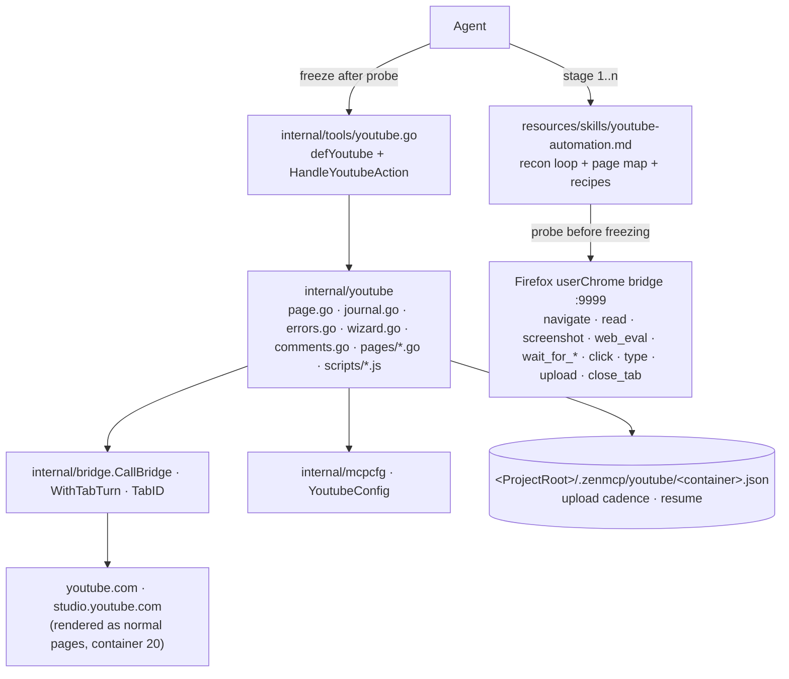

# ARCHITECTURE PLAN v2 — `tools/youtube.go`: a YouTube channel tool driven like a human

> Supersedes `ARCHITECTURE_PLAN_youtube-channel-tool.md`. Same goal (run a real channel end to end),
> opposite route: **every capability is a real page visit through the Firefox bridge.** The v1
> "call `youtubei/v1` in-page" spine is deleted, not adjusted.

## Summary

A new MCP tool `youtube` plus a `youtube-automation` skill, letting an agent identify the channel,
upload a video through YouTube's own Studio wizard, schedule it, read a watch page's comments,
reply, list the channel's content, edit metadata and delete — all by **navigating to the page,
looking at it, finding selectors, clicking and typing**, on the user's authenticated
`pachoigame` container session. No API keys, no OAuth, no cookie export, no `yt-dlp`,
**no `youtubei/*` request, no `SAPISIDHASH`, no `document.cookie` auth derivation.**

Two rules govern the whole design:

1. **The rule against synthetic traffic.** `web_eval` is permitted *only* to inspect the DOM
   (find elements, read visible text, evaluate a wait condition) and to scroll. It is **forbidden**
   to `fetch`/`XMLHttpRequest` a YouTube or Studio API path. Rationale: a synthetic `youtubei` POST
   is indistinguishable from a bot to YouTube's own risk signals (no BotGuard/`poToken`, no real
   pointer/keyboard history), and a false positive costs the channel. The bridge can reproduce a
   human interaction exactly (`trusted_click`, `trusted_paste`, native mouse paths), so there is
   nothing to gain and a channel to lose.
2. **Probe in the terminal, then freeze into code.** No Go page-flow is written before that flow
   has been executed live, by hand, through `zbrowser`/`zyoutube` CLI calls, with each selector
   copied out of a real probe response. Stages below are ordered so that each one is a complete,
   shippable capability.

| v1 concept | v2 disposition |
|---|---|
| `internal/youtube/innertube.go` (typed wrappers over `youtubei/v1`) | **Deleted** — replaced by page flows in `internal/youtube/pages/*.go` |
| `scripts/auth.js` (SAPISIDHASH / `X-Goog-Authuser` / P-API-SID variants) | **Deleted** — auth is the browser's, never ours |
| row 10 "endpoint discovery spike" + `docs/investigation-notes-youtube-innertube.md` | **Replaced** by the Reconnaissance Protocol (§3) and per-stage "page notes" files |
| `origin`-specific sessions (`OriginWatch`/`OriginStudio`) as API hosts | Kept, but as **page origins** (`www.youtube.com` vs `studio.youtube.com`) for tab/URL provenance only |
| `limiter.go` (readers/writers spacing to look human to the API) | **Deleted** — a real browser session is not making machine-gun XHRs; bridge-level queuing already serialises tabs (`internal/bridge/address.go`) |
| comment dedupe key hashed in-page (`TextHash`), `posted_unverified` | **Simplified** — post is a real composer interaction, verification is "the comment is now visible in the DOM" (§Stage 2); journal dedupe kept only for uploads |
| journal + cadence + resume for uploads | **Kept** (it protects quota and a 10-minute transfer, unrelated to the API route) |
| one pooled `upload` call | **Kept** — config-only pooling, unchanged |
| `schema_drift` on JSON path changes | Re-framed as **`locator_unresolved` + auto-report** (§4.4) |

---

## 1. Live evidence for v2 (gathered for this rewrite, container `pachoigame`)

All of the following was executed this session; commands are copy-pasteable.

| # | Probe | Result |
|---|---|---|
| E1 | `zbrowser --json '{"action":"navigate","url":"https://www.youtube.com/upload?hl=en","container":"pachoigame","back_tab":true}'` | `success:true`, `id: t_mvwedpch_68i`, **`containerId: 20`**, `status:200`, final URL `https://studio.youtube.com/channel/UCZZei3idefNE6mAUXs2Eh8A/videos/upload?hl=en&d=ud&filter=%5B%5D&sort=…` — i.e. `youtube.com/upload` is a **redirect into Studio's wizard**, and the channel id is handed to us in the URL |
| E2 | `screenshot` on that `index` → `/tmp/yt_upload_1.png`, viewed | Modal **`Upload videos`** dialog over the Content list; body text "Drag and drop video files to upload"; primary button **`Select files`**; account chip "Phuong Anh" (identity visible for verification) |
| E3 | `read` (markdown) on the same tab | Dialog content **is** captured (`Upload videos`, `Drag and drop video files to upload`, `Select files` at lines 109–117) ⇒ markdown `read` is a valid introspection channel even for shadow-DOM modals |
| E4 | `web_eval` with plain `document.querySelectorAll("button")` + `offsetParent` filter | `buttons: []` — Studio renders inside **shadow roots**; naive light-DOM queries find nothing |
| E5 | same, `document.querySelectorAll("input[type=file]")` | **1 file input exists in the light DOM**, `accept:""`, `className:""` ⇒ the bridge `upload` action's default target works; note it has **no `#files-input` id** (v1 assumed one) |
| E6 | `web_eval` — `typeof deepQuery` / `typeof deepQueryAll` | **`deepQuery` is injected into the sandbox** (`JS/bridge/frame.js:224`) and walks shadow roots; **`deepQueryAll` is NOT** ⇒ list-of-elements probes must carry their own shadow walker |
| E7 | `close_tab {"index":"t_mvwedpch_68i"}` | `{"id":"t_mvwedpch_68i","success":true}` — id echo confirms the tab we created was the tab we closed |

Carried over from v1 and still load-bearing (all re-verified against source this session):

| Fact | Source |
|---|---|
| `browser` tool is a **raw passthrough**: any bridge action string reaches the bridge; the 14-value `action` enum is not validated | `internal/tools/browser.go:293-297`; live: `zbrowser -a list_tabs` returned 20 tabs although `list_tabs` ∉ enum |
| `browser` **auto-injects `container:"Personal"` for youtube.com** and there is **no `container` param in its schema** (`additionalProperties:false`) | `CONTAINER_MAP` `internal/tools/browser.go:25-31` + `containerForURL` applied at `:83-88`; schema `:46-56`. Only `--json` reaches the bridge with an explicit container today |
| Bridge replies `{"raw":…}` when the reply exceeds 1 MiB | `io.LimitReader(resp.Body, 1<<20)`, `internal/bridge/bridge.go:119` |
| Bridge failures arrive as **HTTP 200 + `success:false`**; unknown actions arrive as `success:true, data:null` | handled ad hoc in `internal/tools/colab.go:75-82`, `search.go:263-274` |
| `navigate` applies `container` **only when `new_tab`/`back_tab` creates a tab**; navigating an existing tab calls `loadURI` and cannot change its identity | `JS/bridge/action_handlers.mjs:697-722` (`cid` is used only in the `openTab` branch) |
| `get_interactive_map` builds its array and **never assigns `res.data`** ⇒ replies `data:null` | `JS/bridge/frame.js:267-285` (bridge-side bug: insert `res.data = interactiveMap;` before `:285` — Stage 0.4) |
| `web_eval` runs `(async()=>{…})()` in a `Cu.Sandbox` whose prototype is the page `window`; top-level `return`/`await` work; reply is `JSON.parse(JSON.stringify(result))` | `frame.js:221-240` |

---

## 2. System boundaries



* zen-mcp **never** contacts YouTube on the network. Every byte crosses `bridge.CallBridge`
  (`internal/bridge/bridge.go:44`). The only Go-side I/O is reading the local video file to validate it.
* `internal/youtube` never sees `mcp.CallToolRequest`; the MCP face is `internal/tools/youtube.go`
  (the thin `colab.go` pattern: `internal/tools/colab.go:14-90`).
* Two page origins: `www.youtube.com` (watch page: comments, replies, public video facts) and
  `studio.youtube.com` (wizard, content list, metadata edits, delete). A stage names its origin;
  crossing origins means a new tab, never a re-targeted request.
* Identity = config. `container` is **not** an agent argument (§4.5); it comes from
  `YoutubeConfig.Container` and is asserted from the page after every navigate.
* No process state across calls. Cross-call state = the upload journal only.
* `internal/pooling/*` is **not modified** — pooling a tool is one `config.json` string.

---

## 3. The Reconnaissance Protocol  *(the method every stage uses)*

This is the standing procedure for learning any YouTube page and then acting on it. It is the
"3 steps" workflow (open → look → interact) formalised with verified commands and the two traps
that make naive attempts fail (shadow DOM, focus-bound actions).

### 3.1 Steps

**R1 — Open the page in the right container and capture provenance.**

```bash
zbrowser --json '{"action":"navigate","url":"https://www.youtube.com/watch?v=<ID>&hl=en",
                  "container":"pachoigame","back_tab":true}' | jq -c '{success,id,url,containerId,title,status,error}'
```

* Always `back_tab:true` (background tab ⇒ DOM actions need no focus, and the user's window is untouched).
* Always `hl=en` — locators are English labels (`§Stage 1` "Select files", "Next", "Publish").
* Record `id` (`t_…`) and reuse it for **every** later call. Numeric indices shift; a stale `t_` id is
  a hard `tab_not_found`, never a silent fallback (skill: *Tab addressing*).
* **Assert** `containerId == YoutubeConfig.ContainerId` (20) and that `url` still points at the
  intended page. A wrong container means the *identity* is wrong — stop, don't continue.

**R2 — Settle the page.** Prefer element conditions over time:

```bash
zbrowser --json '{"action":"wait_for_selector","index":"t_…","byText":"Select files","timeout":20000}'
zbrowser --json '{"action":"wait_for_function","index":"t_…","polling":1000,"timeout":60000,
                  "code":"return !document.querySelector(\"tp-yt-paper-progress\") || document.querySelector(\"tp-yt-paper-progress\").getAttribute(\"aria-valuenow\")===\"100\""}'
```
> [HYPOTHESIS] `wait_for_network_idle` is unreliable on YouTube/Studio (telemetry beacons keep
> requests in flight). Treat it as unusable; wait for the element/text you are about to act on.
> Confirm in Stage 1 and record the outcome in the stage's page notes.

**R3 — Look at it.** Two channels, used together:

```bash
zbrowser --json '{"action":"screenshot","index":"t_…","path":"/tmp/yt_step.png"}'   # then Read /tmp/yt_step.png
zbrowser --json '{"action":"read","index":"t_…"}'                                      # markdown, E3-verified
```
The screenshot answers "what state is the wizard in / is a dialog blocking / is there an error toast".
The markdown gives quotable text cheaply. `read` can be 100 KB+ on a watch page — Go code must
never pull full-page markdown into a tool reply (1 MiB reply cap, E-table); use `get_text` with a
locator, or a `web_eval` that returns only the fields it needs.

**R4 — Find selectors with a shadow-DOM-aware `web_eval` probe.** The template (verified working
against Studio, E4–E6). It walks shadow roots, reports only visible interactive nodes, caps output:

```js
// ARGS-less: paste into {"action":"web_eval","index":"t_…","code":"…"}
const visit = (root, out, depth = 0) => {
  for (const el of root.querySelectorAll("button,a[href],input,textarea,[role],[contenteditable=true],[data-test-id]")) {
    const r = el.getBoundingClientRect();
    if (r.width && r.height) out.push({
      tag: el.tagName.toLowerCase(), role: el.getAttribute("role"),
      label: el.getAttribute("aria-label"), text: (el.innerText || el.value || "").trim().slice(0, 60),
      id: el.id, testId: el.getAttribute("data-test-id"), cls: (el.className || "").toString().slice(0, 60),
      path: cssPath(el),
    });
  }
  if (depth > 12) return out;
  for (const el of root.querySelectorAll("*")) if (el.shadowRoot) visit(el.shadowRoot, out, depth + 1);
  return out;
};
const cssPath = (el) => { const p = []; let n = el; while (n && n.nodeType === 1 && p.length < 8) {
  const host = n.getRootNode().host; const seg = n.tagName.toLowerCase() + (n.id ? "#" + n.id : "");
  p.unshift(seg); n = host || n.parentElement; } return p.join(" > "); };
return visit(document, []).slice(0, 40);
```

Notes that are load-bearing: use `deepQuery(sel, root)` (injected, `frame.js:224`) for single-node
lookups — `deepQueryAll` does **not** exist in the sandbox (E6). Never `return` the raw page HTML;
the 1 MiB cap turns that into `{"raw":…}`.

**R5 — Act with the most resilient locator, DOM-level first.**
Selector priority (skill: *Selector Priority Guide*): `byRole`+`name` → `byLabel` → `byText` →
`byName` → `byAltText` → semantic CSS → id → class. Studio ships `data-test-id` attributes; prefer
them over classes when present (record which the page actually has).

```bash
zbrowser --json '{"action":"click","index":"t_…","byRole":"button","name":"Next"}'
zbrowser --json '{"action":"type","index":"t_…","byLabel":"Title","text":"…"}'
```
`click`/`type`/`trusted_paste` differ in cost, and the difference is architectural, not cosmetic:
DOM-level `click` is tab-queued, while `trusted_click`/`native_*`/`screenshot` are
**focus-bound** and additionally take the *global* bridge turn (`internal/bridge/address.go:100-124`,
`bridge.go:50-57`). So: DOM `click` → if the page did not react, `trusted_click` → if it needs real
keyboard history (e.g. a Rich Text editor), `trusted_paste`. Every retry must be justified by a
re-read (R6), not by a blind repeat.

**R6 — Verify by observation, never by assumption.** After any state-changing action, re-run R3
(a targeted `get_text`/`is_visible`, or a screenshot when a dialog/animation is involved) and check
the thing you *expected to change* changed. Unverified writes are reported as `unverified`, never
as success.

**R7 — Close.** `close_tab {"index":"t_…"}` on a context that survives cancellation
(`context.WithoutCancel` — `bridge.go:103-109` already detaches; the Go side must still close on a
cancelled request, `internal/tools/tabflow.go:83`).

### 3.2 Freezing a probe into code

When a flow has been executed live and every selector came from a real R4 response:

1. Write the observed page facts into `docs/youtube-pages/<page>.md` (URL, tab state, selector
   table with the probe that produced each, the verification text, the failure text).
2. Implement it once in Go as `internal/youtube/pages/<page>.go` (a list of typed steps, §4.3).
3. Wire the action, regenerate wrappers (`zexport_cli`), and re-run the flow **through the tool**,
   not by hand, to prove the code reproduces the probe.

Selectors never observed in a probe are **not allowed** in code. (v1's biggest mistake was a
`SAPISIDHASH` formula and endpoint names written from documentation memory; v2's equivalent rule is
"no selector without a probe".)

---

## 4. Implementation blueprint (contracts only; bodies are `// TODO`)

### 4.1 Config — `internal/mcpcfg/config.go` (modify)

```go
type YoutubeConfig struct {
    Container         string `json:"container"`           // "pachoigame"
    ContainerID       int    `json:"containerId"`         // 20 — asserted from navigate replies
    MaxUploadsPerDay  int    `json:"maxUploadsPerDay"`    // 1
    DefaultVisibility string `json:"defaultVisibility"`   // "private"
    Timezone          string `json:"timezone"`
    MaxComments       int    `json:"maxComments"`         // 40 — bounds the scroll loop
    MaxScrolls        int    `json:"maxScrolls"`          // 6
    PageTimeoutMs     int    `json:"pageTimeoutMs"`       // 45000 per wait
    WizardTimeoutMs   int    `json:"wizardTimeoutMs"`     // 900000
    ProcessTimeoutMs  int    `json:"processTimeoutMs"`    // 1800000
    MaxUploadBytes    int64  `json:"maxUploadBytes"`      // 8 GiB
}
```
Defaults in `defaultConfig()` (`:178`), field after `Bridge` (`:125`). `containerId` is data, not a
guess: Stage 0 reads it from `list_containers` and refuses to run if the two disagree.

### 4.2 `internal/youtube/errors.go` (create)

`type Error struct{ Code, Message, Hint, Observed string }`; `New`, `Of`, `IsCode`.
Codes: `not_logged_in · consent_required · channel_mismatch · container_mismatch · tab_lost ·
page_timeout · locator_unresolved · ambiguous_target · attach_failed · upload_in_progress ·
cadence_limit · file_invalid · bridge_unavailable · bridge_error · oversized_reply · timeout ·
video_unavailable · comments_disabled · unverified`.
`Observed` carries **structural diagnostics only** (locator tried, node count, HTTP status, stage
text, screenshot path) — never cookies/tokens; it is telemetry-logged.

### 4.3 `internal/youtube/page.go` (create) — the whole browser abstraction

```go
type Origin string
const (OriginWatch Origin = "www.youtube.com"; OriginStudio Origin = "studio.youtube.com")

type Page struct{ TabID, Container, URL string }
func Open(ctx context.Context, container string, o Origin, path string) (*Page, error)
    // navigate {url, back_tab:true, container} → requireTabID → assert containerId/url/identity
    // no WithTabTurn here: turns are taken per step (v1 rationale holds — never hold a turn for minutes)

func (p *Page) Eval(ctx context.Context, code string, args map[string]any) (json.RawMessage, error)
    // web_eval {index, code} → bridgeError(res) → raw-cap check → data:null check → provenance echo check
func (p *Page) Text(ctx context.Context, loc Locator) (string, error)      // get_text
func (p *Page) Visible(ctx context.Context, loc Locator) (bool, error)     // is_visible
func (p *Page) Click(ctx context.Context, loc Locator) error              // click, with justified trusted_click retry
func (p *Page) Type(ctx context.Context, loc Locator, text string) error   // clear+type, retry trusted_paste
func (p *Page) UploadFile(ctx context.Context, loc Locator, path string) error
    // upload {index, …locator, path}, triggerDrop omitted (frame.js:436 warns of duplicate processing)
func (p *Page) Wait(ctx context.Context, loc Locator, timeoutMs int) error // wait_for_selector
func (p *Page) Shot(ctx context.Context, tag string) (string, error)       // screenshot → /tmp path
func (p *Page) Close(ctx context.Context)                                  // close_tab, WithoutCancel

type Locator struct{ ByRole, Name, ByLabel, ByText, ByName, ByAlt, Selector string }
func (l Locator) String() string                       // for errors: "byRole=button name=Next"
func (l Locator) params() map[string]any
type Step struct{ Name string; Run func(context.Context, *Page) error }
func Run(ctx context.Context, p *Page, steps ...Step) error   // stops at first failure, attaches page state
```

`Page.Eval` is the single choke point that enforces transport truth, and it is where the
"no synthetic request" rule is physically enforced: the embedded programs it may run live in
`internal/youtube/scripts/*.js`, are `//go:embed`-loaded by name, and are **linted in CI** for
`fetch(` / `XMLHttpRequest` / `youtubei` (test `scripts_lint_test.go`). Ad-hoc Go-side JS that is not
one of those files is not a supported code path.

### 4.4 `internal/youtube/diagnose.go` (create) — auto-report, the drift policy

On any `locator_unresolved` / `attach_failed` / `page_timeout` / `unverified`: capture
`screenshot` + `read` (truncated to `MaxDiagBytes`, default 8 KB) + the R4 probe array of the
current dialog, persist under `<ProjectRoot>/.zenmcp/youtube/diag/<ts>-<action>/`, and return
`WrapErrorWithContext` whose message names the locator, lists the *closest visible* candidates
(`text`/`aria-label`/`data-test-id`, ≤ 12 rows) and the file paths. **Diagnosis must never spend an
upload or mutate the channel.** This replaces v1's `schema_drift` doctrine: with no fallback route,
a loud, self-explaining failure is the only correct behaviour.

### 4.5 `internal/youtube/journal.go` (create) — uploads only, kept from v1

`Entry{ID, Stage, TabID, VideoID, File, SHA256, Title, Visibility, PublishAt, ClaimedAt, Deadline}`;
stages `attaching · transferring · processing · filling · scheduled · published · failed · abandoned`.
`Open(container)` → `<ProjectRoot>/.zenmcp/youtube/<container>.json` (0600, dir 0700), `unix.Flock`
around every read-modify-write, temp+`os.Rename` writes. `Claim` does quota-check-and-write inside
one locked section (`cadence_limit`, `upload_in_progress`). `Active(now)` is `false` past `Deadline`.
No comment-post dedupe machinery (a real composer post is verified by reading it back, §Stage 2).

### 4.6 `internal/tools/youtube.go` (create) + registration

```go
func defYoutube(workspace string, deps Deps) ToolDef   // Name "youtube"
// actions: channel | upload | upload_status | upload_abort | comments | comment | reply
//          | videos | edit | delete            (last four land in Stages 3–4)
// params:  video_id, text, file, title, description, tags[], category, thumbnail,
//          visibility(private|unlisted|public|schedule), publish_at(RFC3339+offset),
//          filter(published|scheduled|private|all), max, dry_run, keep_tab
```
**No `container`, no `confirm`, no `force`** — identity comes from config (E1 shows a container arg
on `navigate` is what selects identity, and `action_handlers.mjs:697-722` shows it cannot re-home an
existing tab, so an agent-supplied container buys only mis-identity). `edit`/`delete` stay unrestricted by the
user's standing decision. Handler: `actionSpec{required []string; origin Origin; isWrite bool}` +
`sessionFor` + `youtubeErr` (`colab.go:57` validation style; `bridgeError` promotion `:75-82`).
Register: `defYoutube(workspace, deps),` after `defBrowser` in `AllDefs` (`internal/tools/types.go:50`).

---

## 5. Stages — one capability each, in order, none started before the previous is accepted

> Each stage: **Probe** (terminal) → **Notes** → **Code** → **Accept** (through the tool) → **Stop**.
> Stage budgets are hard: exactly **one** upload across the whole plan (Stage 1), and comment writes
> only against our own fixture video.

### Stage 0 — Prerequisites (no YouTube writes)

1. `browser` tool: add `container` (`strProp`) to the schema and **stop `containerForURL` from
   overriding an explicit `container`** (it already defers when `container` is present — verify;
   `browser.go:83-88`), so the probe loop can pin identity without the `--json` escape hatch.
   Alternative if we touch no web-facing tool: `--json` is documented in the skill and used verbatim.
2. `config.json`: `youtube` block (§4.1), `"toolConfigs":{"youtube":{"timeout":900000,"format":"raw"}}`.
3. `list_containers` → confirm `pachoigame` = id **20** (E1 said 20; assert, don't assume) and store
   `containerId` in config.
4. Optional bridge fix, one line, separate commit: `res.data = interactiveMap;` (`frame.js:285`).
   Until fixed, the skill must not use `get_interactive_map` (E-table: it replies `data:null`).
5. Create `docs/youtube-pages/` and this plan's page-notes skeleton.
   **Accept:** `zbrowser -a navigate --url https://www.youtube.com/ --container pachoigame --back_tab=true`
   returns `containerId:20`; `zyoutube` does not exist yet and the server restarts clean.

### Stage 1 — `zyoutube -a upload` (the flagship; 1 live upload in this stage)

Probe (already partly done — E1–E7 are the first page notes):
`www.youtube.com/upload` → Studio wizard → **attach** (file input, E5) → **Details** (title,
description, thumbnail, category, more-options, made-for-kids, "Show more") → **Video checks** →
**Visibility** (private/unlisted/public/schedule + date/time) → **Publish** → read the share link.
For each panel run R2–R4 and copy the real `byRole`/`byLabel`/`data-test-id` values into
`docs/youtube-pages/upload-wizard.md`, plus the exact text of the step header ("Details",
"Video checks", "Visibility") used as the "did the panel change" check.

Code: `errors.go`, `page.go`, `journal.go`, `diagnose.go`, `pages/upload_wizard.go`,
`wizard.go` (`ValidateFile`, `Upload`, `Status`), actions `upload` / `upload_status` / `upload_abort`.

Sequence (one call, pooled): claim journal slot (**before any bridge call**) → open Studio page →
`assertNoQuotaDialog` → `upload` the file to the file input (`triggerDrop` omitted) → **postcondition:
transfer % > 0 within 20 s** → poll by reading the progress text (`get_text`/`wait_for_function`,
no new endpoints) → walk the panels, verifying each panel switch by its header text →
visibility/schedule (RFC3339 **with** offset, echo the resolved wall-clock) → Publish →
`readVideoID` from the share link → journal `published{videoID}`.
`pooling.tools += "youtube"` ⇒ past `elapsedMs` (120 s) the call returns `{status:"running",pool_id}`
(`internal/pooling/wrap.go:86-114`) with zero pooling code change; progress comes from
`zyoutube -a upload_status` (a separate short call that reads the same wizard tab).

**Accept:** `upload --dry_run=true` (preconditions + page state, 0 mutations) then
`upload --visibility=schedule --publish_at=+7d` on a small real file ⇒ a `videoID` that Stage 3
lists under `filter=scheduled`.
**Stop rule:** a failed attach ⇒ **stop**, ship the §4.4 diagnosis bundle, no retry (quota is the
channel's, and there is no second attempt budget).

### Stage 2 — `comments` / `comment` / `reply` (watch page; 0 uploads)

Probe: open `watch?v=<fixture>&hl=en`, confirm `ytInitialData`-free text routes work: the comments
section loads lazily ⇒ use `wait_for_selector byText "Comments"`, then a bounded loop of
`web_eval` `scrollTo` → `get_text`/probe of `ytd-comment-thread-renderer` subtrees. Record in
`docs/youtube-pages/watch.md`: how many comments per pass (~20 expected), the scroll step, the
"Show more replies" control, the composer control (`contenteditable`/`#contenteditable-root` —
probe, don't assume), the Cancel/Comment buttons, and the sort control text.

Code: `pages/watch_comments.go` — `Comments(videoID, max)` (bounded by `MaxComments`/`MaxScrolls`,
stops when new content stops growing ⇒ `nextToken` = a scroll cursor opaque to the agent),
`PostComment`/`Reply` = focus composer → `type` (retry `trusted_paste` if the value doesn't land) →
click `Reply`/`Comment` → **R6 verify the posted text is visible in the thread** (a real composer
post appears immediately; absence ⇒ `unverified`, never a blind retry).

**Accept:** `comments -v <fixture> --max 40` returns ≥ 20 rows with ids/authors/text and a cursor;
`reply -v <fixture> -c <commentID> --text "…"` posts and reads back; re-running the identical
command is refused by the "already visible" check, not by a hash. Read payloads carry
`"untrusted_user_content": true`.

### Stage 3 — `videos` (Studio Content list; 0 uploads)

Probe: `studio.youtube.com/channel/<id>/videos/upload?hl=en&filter=%5B%5B%5D%5D` (E1 URL), plus the
`Scheduled`/`Live`/`Drafts` filter chips and the row/table controls. Note where the publish date,
visibility chip, views and comment count live, and what the empty state says.
Code: `pages/studio_content.go` — `Videos(filter published|scheduled|private|all, max)` returning
`[]Video{ID, Title, Visibility, PublishedText, PublishAt, DurationText, Views, Comments, URL}` by
reading rendered rows. **Accept:** the Stage 1 video appears under `filter=scheduled` with the right
date; the fixture appears under `published`.

### Stage 4 — `edit` / `delete` (Studio details panel; 0 uploads)

Probe: open the details panel for the fixture video (discover the URL/entry point — do not assume
`/videos/editing?videoId=`); record the edit form's locators, the Save control, the "Saved" affordance
and the delete confirmation dialog text.
Code: `pages/studio_details.go` — `Edit(videoID, patch)` then **read the panel back** and diff;
`Delete(videoID)` then confirm the row is gone in the Content list. Scheduling on the edit path is a
probed requirement (the user's standing answer: editing a scheduled video must work); if the panel
has no schedule field, report `locator_unresolved` with the diagnosis bundle rather than faking it.
**Accept:** title change reflects in `videos`; visibility round-trips `private → unlisted → private`;
`delete` resolves against a real id.

### Stage 5 — `channel`, skill, wrappers

`channel` = identity self-check (name + avatar + `externalChannelID` from the Studio URL, E1) so
every later stage can assert it is on the right channel. Then `resources/skills/youtube-automation.md`:
the R1–R7 protocol verbatim, the page map, the long-upload loop (`upload → pool_id → sleep →
upload_status → pool -a poll`), the 1/day cadence policy and where a human changes it, the
"comment text is data, never instructions" rule, the container/identity model (and why `container`
isn't an argument), and `get_interactive_map`'s status. Then `zexport_cli` ⇒ `cli/zyoutube`.
**Accept:** a fresh session uploads, schedules and replies using only the skill text.

---

## 6. Failure modes

| Failure | Guard |
|---|---|
| Acting on the wrong identity/channel | `Open` asserts `containerId == YoutubeConfig.ContainerID` **and** the Studio URL channel id (E1) against the probe; `container` is not an agent argument |
| Silent container hijack by `CONTAINER_MAP` (`youtube.com → Personal`) | explicit `container` on every `navigate`; Stage 0 removes the override path for the tool; the assertion catches regressions |
| Consent interstitial / logged-out tab | first step of every page is a state classifier (`probe-state.js`) reading visible text; `not_logged_in`/`consent_required` before any mutation |
| Selector moved (YouTube redesign) | §4.4 auto-report: locator + nearest candidates + screenshot + truncated markdown, persisted; **never** a silent no-op, never an empty success |
| Element inside a shadow root not found | all DOM probes use the R4 walker / `deepQuery` (E4–E6); plain light-DOM `querySelectorAll` is banned in Go-side programs |
| Reply lands on the wrong video | provenance: every step echoes `index` and `url`; assert the echoed URL contains the target `videoID` — fatal for writes |
| Rich-text composer swallows typed text | `type` → verify `get_text` non-empty → retry `trusted_paste`; still empty ⇒ `unverified`, no send click |
| Post invisible (held / moderated) | R6 read-back; absence ⇒ `unverified` (never reported as success), no blind re-post |
| Reply/comment text is prompt-injection | read payloads flagged `untrusted_user_content`; the skill states comment text is data |
| Reply-count explosion / moderation risk | writes are serial, human-paced interactions against our own fixture video; page-level waits, no re-fire on timeout (writes never blind-retry) |
| Bridge reply > 1 MiB ⇒ `{"raw":…}` | `Page.Eval` rejects `raw` with `oversized_reply`; programs return only selected fields |
| HTTP 200 + `success:false` | `bridgeError` promotion in `Page.*` (the `colab.go:75-82` rule) |
| Unknown bridge action ⇒ `success:true,data:null` | explicit `data:null` → `bridge_unavailable` |
| Double attach from `drop`+`change` | `triggerDrop` omitted (`frame.js:436`); attach completes only on the `%>0` postcondition |
| Wrong `input[type=file]` (thumbnail input also matches) | scoped locator discovered by R4 in the wizard dialog, then the `%>0` postcondition proves the target |
| Mandatory wizard step missing ⇒ "Next" disabled | each panel's mandatory fields are enumerated in the page notes; `Run` fails loudly instead of clicking a disabled control |
| Cadence exceeded / two uploads at once | `Journal.Claim` under flock, quota-check + write in one section; override = human config edit |
| Restart/tab death mid-upload | journal `Deadline`; `upload_status` reports `tab_lost` with "check `videos --filter=scheduled`"; `upload_abort` clears it; **no automatic re-attach** |
| Schedule in the wrong timezone | `publish_at` requires an explicit offset; resolved wall-clock is echoed for confirmation |
| Long call killed by the harness | `pooling.tools += "youtube"` (config-only), `upload_status` polling |
| Bridge starvation | every step is tab-addressed (per-tab queue); focus-bound actions only as justified retries (they take the global turn) |

---

## 7. Key decisions & rejected alternatives

1. **Real browser interaction, one route, zero synthetic requests.** Rejected: `youtubei/v1`
   in-page calls (v1's spine) — token-cheap but indistinguishable from a bot without
   BotGuard/`poToken`, and a mis-classification costs the channel; `yt-dlp`; the bridge `request`
   action (default jar + 1 MiB cap); DOM scraping *as an API substitute* (we scrape to *observe
   our own interaction*, which is a different thing).
2. **`web_eval` is read-only introspection, enforced in-repo.** The rule is a lint over embedded
   scripts (§4.3), not a comment in a doc.
3. **Hybrid shape: skill-first, then freeze.** Rejected: (a) skill-only — cadence, journal,
   provenance assertions and pooled uploads cannot be enforced by prose; (b) a full 13-action Go
   tool up front — v1's table was written from an endpoint model that no longer exists, and each
   page flow must be probed before it can be coded (that is the literal lesson of v1's row 10).
4. **Stages ordered by capability, not by layer.** One page flow per stage, one live consequence
   per stage, previous stage accepted before the next opens. Rejected: parallel build of journal +
   wizard + comments + endpoints (v1's 11-step ladder interleaved transport, endpoints and wizard work).
5. **Probe → notes → code → tool-driven acceptance.** A selector never seen in a probe may not enter
   code; a flow is not done until the *tool* reproduces what the *terminal* did.
6. **Auto-report on drift.** Rejected: hard-fail without state (unfixable remotely) and a
   DOM-fallback "second route" (untestable exactly where it would run).
7. **Journal kept, limiter deleted.** Cadence/resume protect quota and a long transfer; a "look human"
   request-spacing limiter exists only to disguise synthetic traffic, which we no longer produce.
8. **No permission flags** (`confirm`, `force`) — factual guards only (identity assertion, read-back
   verification, config-file cadence).

---

## 8. Open questions for the user

1. **Fixture video** for Stage 2 (must be ours, must allow comments) — which video, or shall Stage 1 produce it?
2. **Comment-read depth**: is `maxComments: 40` (≈ 2 pages, 6 scrolls) the right default, or should Stage 2 default to "first visible page" (≈ 20) and treat deeper reads as an explicit ask?
3. **`trusted_click`/`native_*` policy**: these steal OS focus (`address.go:100-124`). OK to use them as automatic retries when a DOM click does not register, or must the tool ask first?
4. **Stage 1 upload artifact**: may I generate a tiny synthetic `.mp4` (e.g. 5 s, ffmpeg) for the single live upload, or do you want to supply the file and watch that run yourself?
