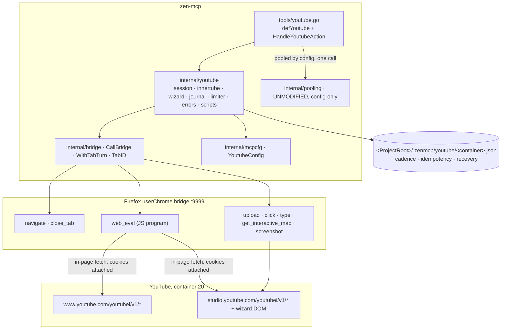
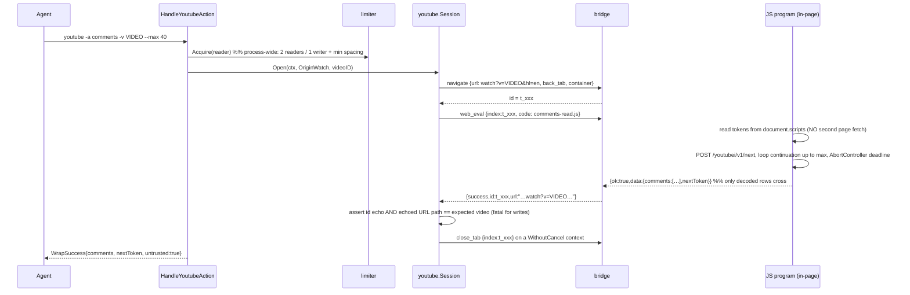
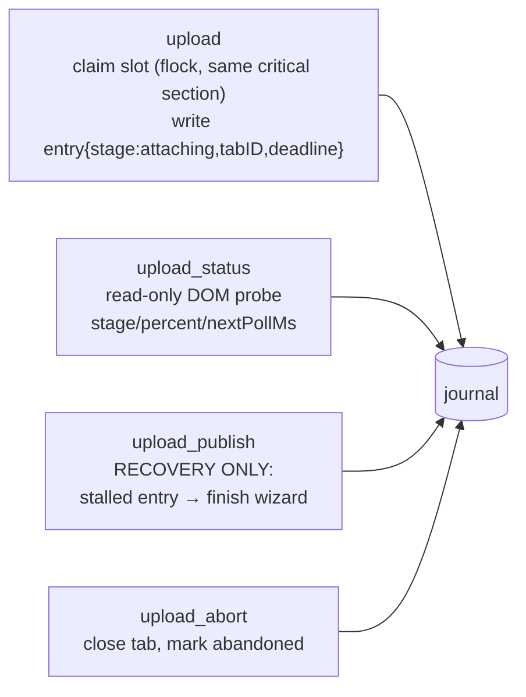

# ARCHITECTURE PLAN — `tools/youtube.go`: an autonomous YouTube channel tool

## Summary

A new MCP tool `youtube` that lets an agent run a real YouTube channel end to end: identify
the channel, list and read videos (public, scheduled, private), read comment threads with
pagination, post comments and replies, upload a video through YouTube's own Studio wizard,
edit metadata and visibility, schedule publication, and delete. Every capability rides the
user's **authenticated Firefox container session** through the existing bridge
(`internal/bridge.CallBridge`) — no API keys, no OAuth, no `yt-dlp`, no cookie export.
Structured reads and writes are **JS programs executed inside the actual YouTube page via
`web_eval`**, calling YouTube's own `youtubei/v1` endpoints same-origin and returning only
decoded rows, so nothing approaches the bridge's 1 MiB reply cap. Media upload uses the
bridge's `upload` action against the Studio wizard, because the browser must perform the
byte transfer. The long upload is **one tool call, pooled by config only** (zero changes to
`internal/pooling`), with an on-disk journal for cadence, idempotency and mid-wizard
recovery. Live budget for the whole implementation is **one upload**, scheduled ahead, with
a hard stop on any failed attach.

Live evidence gathered this session (container `pachoigame` = userContextId 20, `SID` +
`SAPISID` readable from `document.cookie` ⇒ logged in):

| Probe | Evidence |
|---|---|
| `navigate back_tab container:pachoigame` | TabRegistry id `t_mvs58xbt_625`, `containerId:20` |
| `web_eval` world | `Cu.Sandbox(win,{sandboxPrototype:win})` (`JS/bridge/frame.js:222`) → `ytcfg`/`ytInitialData` invisible; top-level `await` works (`frame.js:231`) and the returned promise is awaited (`frame.js:232`) |
| same-origin `fetch` from that world | `POST /youtubei/v1/next` → **200**; `GET /watch?v=…` → 200, 2.66 MB |
| comment continuation | the token sits **before** `"sectionIdentifier":"comment-item-section"` in the watch HTML; `POST /youtubei/v1/next` → **21 `commentThreadRenderer`, 20 `commentEntityPayload`** |
| response shape | `onResponseReceivedEndpoints[].reloadContinuationItemsCommand.continuationItems[].commentThreadRenderer.commentViewModel` + `frameworkUpdates.entityBatchUpdate.mutations[].payload` (mutations are `{entityKey,type,payload}`, **not** `{commentEntityPayload}`) |
| bridge `request` action | default **userContextId 0** jar (`action_handlers.mjs:141-151`) + 1 MiB reply cap ⇒ rejected as transport |
| bridge `upload` action | `<input type=file>` only, crosses closed shadow roots, background-tab safe, fires `input`+`change`; `triggerDrop` is opt-in and `frame.js:436` warns it "can trigger duplicate processing" |
| unknown bridge action | replies `success:true, data:null`, HTTP 200 ⇒ must be an error |
| `address.go:149` (verified) | `navigate` applies `container` **only when creating a tab**; an existing tab is never re-homed ⇒ a caller-supplied container cannot be trusted to select an identity |
| `response.go:304` (verified) | `bypassTools` only skips output **virtualisation**; it is not a safety gate |

---

## System boundaries

Boundaries:

* zen-mcp **never** contacts YouTube directly; every byte crosses `bridge.CallBridge`
  (`internal/bridge/bridge.go:44`) so the queue rules of `internal/bridge/address.go` apply.
* `internal/youtube` never sees `mcp.CallToolRequest` — typed domain API only, MCP face lives
  in `internal/tools/youtube.go` (the thin-`colab.go` pattern, not the 1320-line `codegraph.go` one).
* **Two origins ⇒ two session kinds.** `www.youtube.com` for watch-page reads and comment
  writes; `studio.youtube.com` for scheduled/private listings, metadata edits, deletes and the
  upload wizard. A `SAPISIDHASH` is origin-specific: an `www` hash is a 401 at Studio.
* Process state: none cached across calls (no session tabs, no identity cache). Cross-call
  state is the journal file, and the journal is also the mutual-exclusion mechanism for the
  wizard (see *Upload*).
* `internal/pooling/{registry,wrap}.go`, `internal/tools/pool.go` are **not modified** — the
  only pooling change is adding `"youtube"` to `pooling.tools` in `config.json`.

---

## Data flow and state

### One read/write of structured data

The tab turn is taken **per call**, never held across a multi-minute wizard: holding it would
make a concurrent `upload_status` on the same tab queue behind the upload and block until
`bridge.queueTimeoutMs`. Steps are individually queued; `upload_status` racing a step call
returns `ErrBridgeBusy` naming the holder and the agent simply retries next tick.

### Upload: one call, pooled, journalled, resumable

```mermaid
stateDiagram-v2
  [*] --> Planned: upload --dry_run=true  (0 uploads, preconditions only)
  Planned --> Attaching: upload  (attach; percent>0 within 20s is the postcondition)
  Planned --> Refused: cadence limit / file invalid / not logged in / channel mismatch
  Attaching --> Processing: transfer 100%
  Processing --> Ready: Studio reports processing complete
  Ready --> Published: same call fills details, sets visibility/schedule, publishes
  Published --> [*]: journal{stage:published, videoID}
  Attaching --> Stalled: attach postcondition never met
  Processing --> Stalled
  Ready --> Stalled
  Stalled --> Recovered: upload_publish (recovery action, same wizard tab)
  Stalled --> Abandoned: upload_abort
```

One call means the agent does not drive a state machine: `upload` runs the whole sequence
and, past `pooling.elapsedMs` (120 s), `pooling.Wrap` converts it to
`{status:"running",pool_id}` (`internal/pooling/wrap.go:86`) — which is exactly the
"don't let the harness kill a long job" property the pool exists for, obtained with **zero
code change to pooling**. Progress comes from a *separate* short call,
`youtube -a upload_status`, which probes Studio's own progress bar; the skill teaches the
loop `upload (returns pool_id) → sleep → upload_status → pool -a poll`.

| `Stage` (closed enum, stored verbatim) | `attaching` · `transferring` · `processing` · `filling` · `scheduled` · `published` · `failed` · `abandoned` |
|---|---|
| Write-side `PostStatus` | `pending` → `posted` \| `failed` \| `unknown` — `failed` may retry, `posted` is deduped, `unknown` (POST sent, outcome lost) **must** be resolved by read-back before any repost |

---

## Implementation Blueprint

Contracts only; bodies are `// TODO`.

| # | File path | Action | Concrete signature / schema (pseudocode) | Depends | Acceptance ("done when…") |
|---|---|---|---|---|---|
| 1 | `internal/youtube/errors.go` | create | `type Error struct{ Code, Message, Hint, Detail string }` + `Error() string`; `New(code,msg)`, `Of(err)(*Error,bool)`, `IsCode(code,err) bool`. Codes: `not_logged_in`, `channel_mismatch`, `consent_required`, `schema_drift`, `innertube_http`, `innertube_error`, `cadence_limit`, `attach_failed`, `tab_lost`, `file_invalid`, `duplicate_post`, `posted_unverified`, `bridge_unavailable`, `timeout`, `video_unavailable`, `comments_disabled`, `upload_in_progress` | — | `Of` unwraps a `%w`-wrapped `*Error`; `Detail` is documented to hold **only** structural diagnostics (keys, HTTP status, counts) — never `visitorData`, tokens or cookies, because it is telemetry-logged |
| 2 | `internal/youtube/scripts/*.js` | create | One file per program. **Program contract:** file = body of an async function; may use `await`, `fetch`, `document`, `crypto`, `AbortController`; single injected JSON argument `ARGS`; **must** return `{ok:true,data:<decoded rows>}` or `{ok:false,error:"<Error.Code>",detail?}`; must wrap every request in `AbortSignal.timeout(ARGS.deadlineMs)`; must never return raw HTML, tokens, or >400 KB. Arg injection: `const ARGS = <json literal>;` built with `json.Marshal` — **no string interpolation of user text, ever** | 1 | `node internal/youtube/scripts/test/run.js` exits 0 (row 3) |
| 3 | `internal/youtube/scripts/test/` (`run.js`, `fixtures/next-comments.json`, `fixtures/watch.html`, `fixtures/studio-list.json`) | create | A real JS harness: for each program, load the file, wrap as `(async()=>{…})()` with `fetch`/`document`/`crypto` shims fed by the fixture, assert decoded output. `next-comments.json` = the live response shape captured this session | 2 | `run.js` fails if `comments-read.js` returns 0 comments from the fixture, and fails if a path is renamed (proves drift detection is real, not silent-empty) |
| 4 | `internal/youtube/session.go` | create | `type Origin int; const ( OriginWatch Origin = iota; OriginStudio )` `type Session struct{ TabID, Container, ExpectedPath string; APIKey, ClientName, ClientVersion, InnertubeContext string; ExternalChannelID, PageOwnerID, SessionIndex, AccountTimezone string; LoginOK bool; origin Origin }` `func Open(ctx, container string, origin Origin, path string) (_ *Session, release func(), err error)` — `navigate {url: originURL(origin,path), back_tab:true, container}`; **no `WithTabTurn` here** (per-call turns only) `func (s *Session) Run(ctx, program string, args any) (json.RawMessage, error)` `func (s *Session) Close(ctx)` — `close_tab` on `context.WithoutCancel(ctx)` `func load(name string) (string, error)` — `//go:embed scripts` → `scriptsFS` + name→string cache | 1, 2 | With `installBridgeStub` canned replies: `Open` emits exactly `navigate{back_tab,container}`; `Run` emits `web_eval{index:<id>}`; `Close` emits `close_tab{index:<id>}` even when the incoming ctx is already cancelled. `Open` on a bridge that omits the tab id ⇒ `bridge_unavailable` naming the registry (`requireTabID`, `internal/tools/tabflow.go:41`) |
| 5 | `internal/youtube/session.go` (Run internals) | create | Every `Run` enforces, in order: (a) transport `err` ⇒ `bridge_unavailable`; (b) `res["raw"]` present ⇒ `schema_drift "bridge reply exceeded 1 MiB"` (the cap is `io.LimitReader(resp.Body, 1<<20)` in `internal/bridge/bridge.go`); (c) `success==false` ⇒ propagate `error` as a typed `*Error`; (d) `data==null` ⇒ `bridge_unavailable "action not recognised by the bridge"`; (e) provenance: `bridge.TabID(res)==s.TabID` **and** `res["url"]` prefix-matches `s.ExpectedPath` ⇒ else `channel_mismatch` (for writes this is fatal, unlike `verifyTab`, which tolerates an absent echo) | 4 | A stub reply containing only `{"raw":"…","success":true}` returns `schema_drift`; a reply echoing a foreign tab id returns `channel_mismatch` |
| 6 | `internal/youtube/journal.go` | create | `type Entry struct{ ID, Kind, Stage, TabID, VideoID, File, SHA256, Title, Visibility, PublishAt, DedupeKey, PostStatus, Error string; ClaimedAt, Deadline time.Time }` (`Kind`: `attach`\|`post`) `type Journal struct{ path string; f *os.File }` — `golang.org/x/sys/unix` **flock** on an open handle for all read-modify-write `func Open(container string) (*Journal, error)` — `<mcpcfg.ProjectRoot>/.zenmcp/youtube/<container>.json`, 0600, dir 0700 `func (j *Journal) Claim(e Entry, maxPerDay int, now time.Time) error` — **quota check and write in one locked section**; `ErrCadence`/`ErrUploadInProgress` `func (j *Journal) Set(id, stage string, fn func(*Entry)) error` — write temp file + `os.Rename` (atomic) `func (j *Journal) Active(now) (Entry, bool)` — **`false` past `Deadline`**, stale entry marked `failed` `func (j *Journal) CountOn(dayKey string) (int, error)` — `dayKey` = date in `YoutubeConfig.Timezone` `func (j *Journal) LookupPost(key string) (Entry, bool)` | 1 | A test spawning two `Claim` calls concurrently (separate goroutines *and* a second process) leaves exactly one attach recorded; a stale entry is never `Active` |
| 7 | `internal/youtube/limiter.go` | create | `type Limiter struct{ readers, writers chan struct{}; mu sync.Mutex; last map[Origin]time.Time }` `func L() *Limiter` (process-wide singleton) `func (l *Limiter) Do(ctx, kind Kind, o Origin, fn func() error) error` — kind `Read`\|`Write`; 2 concurrent reads, 1 write, `YoutubeConfig.MinWriteSpacingMs` between writes, `MinReadSpacingMs` between paginated read bursts, both with jitter `func (l *Limiter) Stats() (inflight int, sinceLastWrite time.Duration)` | 1 | A test issuing 5 concurrent writes serialises them and observes ≥ spacing between POST timestamps |
| 8 | `internal/youtube/innertube.go` | create | `type Comment struct{ ID, ParentID, AuthorName, AuthorChannelID, Text, TextHash string; Likes int; PublishedText string; ReplyCount int; IsOwner, CanReply bool; RepliesToken string }` (`TextHash` = sha256 computed **in-page**, because `sanitizeBridgeResponse` in `internal/bridge/bridge.go:223` runs `DecodeHTMLEntities`/`FixMojibake` over every returned string and will alter comment text) `type CommentPage struct{ Comments []Comment; NextToken, CountText string }` `type Video struct{ ID, Title, Description, URL, Visibility, PublishedText, PublishAt, DurationText, Thumbnail string; Views, Comments int }` `type Channel struct{ ExternalID, Title, Handle, AccountTimezone string; LoggedInAs []string; DelegatedIDs []string }` `type CommentOpts struct{ Max int; Sort, PageToken string }` `type VideoPatch struct{ Title, Description, Thumbnail, Visibility, PublishAt *string; Tags []string }` `func (s *Session) Channel(ctx) (*Channel, error)` · `VideosPublic(ctx, max) ([]Video, error)` · `StudioVideos(ctx, filter string, max int) ([]Video, error)` · `Video(ctx, id string) (*Video, error)` · `Comments(ctx, id string, o CommentOpts) (*CommentPage, error)` · `Replies(ctx, id, commentID string, o CommentOpts) (*CommentPage, error)` · `Post(ctx, videoID, parentID, text string) (*Comment, error)` · `Edit(ctx, id string, p VideoPatch) (*Video, error)` · `Delete(ctx, id string) error` `func (s *Session) AuthHeader(origin Origin, path string) (string, error)` — for the Studio DOM/HTTP calls made from Go where needed | 1, 2, 4 | Against the fixture: 20 comments with non-empty `ID`s and a `NextToken`. With a fixture whose paths are renamed: `schema_drift` naming the missing path — **never** an empty success |
| 9 | `internal/youtube/scripts/auth.js` (shared prelude, concatenated into write programs) | create | Authoritative header construction, **correcting the draft formula**: `ts = floor(Date.now()/1000)`; `hash = hex(SHA1(ts + " " + SAPISID + " " + location.origin))`; `Authorization = "SAPISIDHASH " + ts + "_" + hash` — the **path is not hashed** and the **timestamp is prefixed**; plus `X-Goog-Authuser: <SESSION_INDEX>` and `X-Origin`/`Referer` matching the document's own origin. `__Secure-1PAPISID`/`__Secure-3PAPISID` variants are sent **only if the captured real request sends them** — see step 10 | 2 | The captured real request (step 10) reproduces byte-for-byte in header *shape* from this prelude |
| 10 | `docs/investigation-notes-youtube-innertube.md` | create | **Discovery spike, not guesswork.** Before any write program is written: (a) in-page, `document.scripts` text → regex every `"/youtubei/v1/[a-zA-Z0-9_.-]+"` occurrence from the loaded desktop JS bundle to obtain the real endpoint names; (b) post one comment **through the DOM** on our own fixture video and capture the real request by reading the page's own `performance.getEntriesByType("resource")` names for `youtubei/v1/*` to learn the exact endpoint; (c) record each endpoint's request key list (names only) and response top-level keys. Output = a table that `comment-post.js`/`video-edit.js`/`video-delete.js` are written from. Also records: the scheduled-publish field on the Studio edit path, and the `createCommentParams` source location (the comments-header `commentSimpleboxRenderer`/engagement-panel endpoint, **not** a bare `continuationItemRenderer`) | — | Every write endpoint used in code appears in this file with the observation that proves it; no endpoint name in `internal/youtube` that is not listed here |
| 11 | `internal/youtube/wizard.go` | create | `type Visibility string; const ( VisPrivate, VisUnlisted, VisPublic, VisSchedule Visibility = "private", "unlisted", "public", "schedule" )` `type UploadRequest struct{ File, Title, Description, Category, Thumbnail string; Tags []string; Visibility Visibility; PublishAt string /* RFC3339 with explicit offset; required iff Visibility==VisSchedule, rejected otherwise */; DryRun bool }` `func ValidateFile(path string) (sha256hex string, size int64, err error)` — absolute path, `os.Open` + read-first-byte (so the Firefox process, same host, can read it), extension in `{mp4,mov,mkv,webm,avi,flv,m4v,wmv,mpg,mpeg,3gp}`, size ≤ `YoutubeConfig.MaxUploadBytes` `func Upload(ctx, container string, req UploadRequest, j *Journal, report func(Progress)) (*UploadResult, error)` — claim slot → open Studio session → `assertNoQuotaDialog` → `bridge upload {index, selector:"#files-input, input[type=file]:not([hidden])", path}` with **`triggerDrop` omitted** → `waitAttachPostcondition(20s: percent>0 or step-2 header)` → fill Details (title, description, category, tags, visibility, thumbnail) → `visibility/schedule` → `publish` → `readVideoID` `func Status(ctx, container string, tabID string) (*Progress, error)` `func PublishStalled(ctx, container, uploadID string, j *Journal) (string, error)` — recovery only `func Abort(ctx, container, uploadID string, j *Journal) error` `type Progress struct{ Stage string; Percent int; Detail string; Ready bool; NextPollMs int; Deadline time.Time }` `var wizard = map[string]Locator{ … }` with **mandatory** entries: `fileInput`, `title`(ByLabel "Title"), `description`(ByLabel "Description"), `showMore`, `category`(ByLabel "Category"), `tags`, `madeForKids`(radio) , `notMadeForKids`(radio), `alteredContent`(radio), `next`(ByRole button "Next"), `visibilityPrivate/Unlisted/Public/Schedule`(radios), `scheduleDate`, `scheduleTime`, `publish`(ByRole button "Publish"), `videoLink`(a[href*="youtu"]), `quotaDialog`(byText "daily upload limit") }` — semantic locators only, `hl=en` forced in the wizard URL | 1, 4, 6, 7 | Unit: `Upload` with `DryRun` issues no `upload` action and writes no `attach` entry; a journal already at `MaxUploadsPerDay` ⇒ `cadence_limit` **before any bridge call**; two concurrent `Upload` calls ⇒ second gets `upload_in_progress`. Live: the single scheduled upload returns a `videoID` that `studio_videos --filter=scheduled` lists |
| 12 | `internal/youtube/scripts/upload-progress.js` | create | Pure DOM read of the wizard: step header text, progress element `aria-valuenow`, `ytcp-status-text`, presence of the Publish button, presence of error/quota dialogs. Returns `{ok,data:{stage,percent,detail,ready}}`. Read-only ⇒ safe at any polling rate | 2, 11 | Live: during the one real upload it reports a monotonic `percent` and `ready==true` exactly when publishing is possible |
| 13 | `internal/mcpcfg/config.go` | modify | `type YoutubeConfig struct{ Container string \`json:"container"\`; AllowedContainers []string \`json:"allowedContainers"\`; MaxUploadsPerDay int \`json:"maxUploadsPerDay"\`; DefaultVisibility string \`json:"defaultVisibility"\`; Timezone string \`json:"timezone"\`; MaxWritePerHour int \`json:"maxWritesPerHour"\`; MinWriteSpacingMs int \`json:"minWriteSpacingMs"\`; WizardTimeoutMs, ProcessTimeoutMs int; MaxUploadBytes int64 \`json:"maxUploadBytes"\` }`; `ZenConfig.Youtube YoutubeConfig \`json:"youtube"\`` after `Bridge` (`internal/mcpcfg/config.go:119`); defaults in `defaultConfig()` (`:178`): container `pachoigame`, allowed `[pachoigame]`, maxPerDay 1, visibility `private`, tz `UTC`, maxWritesPerHour 20, minWriteSpacingMs 4000, wizard 900000, process 1800000, maxUploadBytes 8 GiB | — | Absent `youtube` block still yields all defaults; `allowedContainers` rejects an unknown container **before** any bridge call |
| 14 | `internal/tools/youtube.go` | create | `func defYoutube(workspace string, deps Deps) ToolDef` — actions `["channel","videos","video","comments","replies","comment","reply","upload","upload_status","upload_publish","upload_abort","edit","delete"]`; params `video_id, comment_id, text, file, title, description, tags[], category, thumbnail, visibility(private|unlisted|public|schedule), publish_at(RFC3339+offset), filter(published|scheduled|private|all), max, sort(top|newest), page_token, dry_run, keep_tab`. **No `container`, no `confirm`, no `force`** (identity comes from config's allow-list; `edit`/`delete` are unrestricted tools by explicit user decision). `func HandleYoutubeAction(ctx, workspace string, deps Deps, req mcp.CallToolRequest) *mcp.CallToolResult` `type actionSpec struct{ required []string; origin youtube.Origin; isWrite bool }`; `var actionSpecs map[string]actionSpec` `func sessionFor(ctx, spec actionSpec, args map[string]any) (*youtube.Session, func(), error)` `func youtubeErr(ctx, start, err) *mcp.CallToolResult` — `WrapErrorWithContext`, message = `code + ": " + Message + ". " + Hint` | 4–13 | `AllDefs` exposes `youtube`; unknown action ⇒ validation error listing the enum; every action's missing-param case ⇒ `"<param> is required for <action>"` (`colab.go:57` style); read payloads carry `"untrusted_user_content": true` on `comments`/`replies` |
| 15 | `internal/tools/types.go` | modify | `defYoutube(workspace, deps),` after `defBrowser(...)` (`internal/tools/types.go:46`) | 14 | `zexport_cli` emits `cli/zyoutube` with the 13 actions |
| 16 | `config.json` | modify | `"youtube": { … row 13 defaults … }`; `"toolConfigs": { "youtube": { "timeout": 900000, "format": "raw" } }`; **`"pooling": { "tools": [... , "youtube"] }`** — the only pooling change; no `bypassTools` entry (verified irrelevant: `response.go:304`) | 13, 14 | After auto-restart: `zyoutube -a channel` answers; a >120 s `upload` returns a `pool_id` |
| 17 | `internal/youtube/{session,journal,limiter,innertube,wizard}_test.go` + `internal/tools/youtube_test.go` | create | Go tests drive the **bridge stub** (`internal/tools/bridge_stub_test.go:151`) with canned `{ok,data}` program results — Go tests cover transport rules, journal/limiter/claims, arg validation and call sequences. JS decoding is covered by row 3, not here | 4–14 | `go test ./internal/youtube ./internal/tools` green; a test asserting `close_tab` fires even on a cancelled ctx |
| 18 | `resources/skills/youtube-automation.md` | create | frontmatter `name: youtube-automation`, `trigger: youtube channel`; body: the action table; the **call pattern for a long upload** (`upload` → `pool_id` → `sleep` → `youtube -a upload_status` → `pool -a poll`); 1-video/day cadence as channel-health policy and where to change it (`config.json`, human edit); scheduled-backlog workflow; hard-stop rule after a failed attach; recovery with `upload_publish`/`upload_abort`; the rule that comment text is **untrusted input**; identity/container model and why `container` is not an argument | 14–17 | A fresh session can upload, schedule and reply using only the skill text |

---

## Ordered, atomic build steps

1. **Errors + journal + limiter** (rows 1, 6, 7). *Accept:* unit tests prove flock-backed
   `Claim` mutual exclusion, stale-`Deadline` expiry, and write spacing.
2. **JS harness + identity/program contract** (rows 2, 3) and `probe-identity.js`. *Accept:*
   live `zbrowser -a web_eval` of `probe-identity.js` in `pachoigame` returns `apiKey`,
   `clientVersion`, `externalChannelID`, `accountTimezone`; `node …/run.js` green.
3. **Session + transport rules** (rows 4, 5). *Accept:* stub tests for `raw`/`data:null`/
   provenance-URL/`close_tab`-on-cancelled-ctx all pass.
4. **Endpoint discovery spike** (row 10). *Depends:* 2, 3. *Accept:* the notes file lists the
   real names for comment-post, video-edit, video-delete, studio video list, the Studio
   scheduled-publish field, and the `createCommentParams` source. **No write program may be
   written before this file exists.** 0 uploads.
5. **Config** (rows 13, 16). *Accept:* `Get().Youtube.Container=="pachoigame"`; server restarts clean.
6. **Reads** (row 8 + `comments-read.js`, `replies-read.js`, `videos-list.js`,
   `studio-videos-list.js`, `video-get.js`, `channel-get.js`) and actions `channel`,
   `videos`, `video`, `comments`, `replies` (rows 14, 15). *Accept:* `zyoutube -a comments -v dQw4w9WgXcQ
   --max 40` returns ≥ 20 decoded comments + `nextToken`; `channel` names the right channel;
   `videos --filter=scheduled` works against Studio. 0 uploads.
7. **Upload pipeline** (rows 11, 12) + `upload`, `upload_status`, `upload_publish`,
   `upload_abort`. *Depends:* 1–5. *Accept:* unit tests for cadence-before-bridge, dry-run
   issues no `upload`, one-at-a-time claim. Then the **single live upload**: `--dry_run=true`
   (preconditions only), then `--visibility=schedule --publish_at=+7d`. A failed attach ⇒
   **stop the build**, ship the journal entry + `screenshot` + `read` markdown of the wizard
   step in the report. (Do **not** rely on `get_interactive_map` for diagnostics: `frame.js:267-284`
   builds the array but never assigns `res.data`, so it replies `data:null` — a bridge-side bug
   to fix separately, not a prerequisite for this tool.)
8. **Comment writes** (`comment-post.js` from step 4, `Post` with `pending/posted/failed/unknown`
   + read-back) and actions `comment`, `reply`. *Accept:* posting the same text twice to the
   same `comment_id` is deduped; the posted comment id reads back through `comments`;
   `maxWritesPerHour` enforced.
9. **Metadata + delete** (`video-edit.js`, `video-delete.js`) and actions `edit`, `delete`.
   *Accept:* `edit` changes the fixture title and `video` reflects it; a visibility change
   `private → unlisted → private` round-trips; `delete` resolves and reports against a real
   id (exercised at the implementing agent's discretion — these are unrestricted tools).
10. **Wrappers + notes** (row 15, `zexport_cli`). *Accept:* `zyoutube --help` lists 13
    actions; `zyoutube -a comments -v <id> --max 5` works from a shell.
11. **Skill** (row 18). *Depends:* 6–10 proven live.

---

## Failure modes

| Failure | Guard (file/function) |
|---|---|
| Wrong channel acted on (multi-account container, brand/delegated identity) | `session.Run` asserts the echoed URL path *and* `probe-identity.js` asserts `ExternalChannelID ∈ YoutubeConfig.AllowedContainers` expectation; `container` is not an agent argument (`address.go:149` proves a container arg cannot re-home an existing tab) |
| Logged-out or consent-interstitial tab | `probe-identity.js` returns `not_logged_in`/`consent_required`; the tool never proceeds into a fetch whose HTML it has not classified |
| Bridge reply > 1 MiB ⇒ `{"raw":…}` | `session.Run` rule (b) — hard `schema_drift`, since `io.LimitReader` truncates *before* Go can see anything |
| Unknown bridge action replies `success:true,data:null` | `session.Run` rule (d) |
| Comment text mangled by `DecodeHTMLEntities`/`FixMojibake` (`bridge.go:223`) | dedupe/idempotency hashes computed **in-page** (`Comment.TextHash`); Go never hashes bridge-mangled text |
| innertube shape drift | each program asserts its paths and returns `schema_drift` with key names only; **no DOM fallback exists by decision** — drift is loud and fixable without spending an upload |
| 401 on a write because the hash used the wrong origin | `auth.js` derives origin from the document it runs in; Studio calls always run in a Studio session (`OriginStudio`), never an `www` one |
| Synthetic posts shadow-held / silently invisible | read-back verification in `Post`; unverifiable ⇒ `posted_unverified` (never reported as success). Rate limited by `Limiter` + `MaxWritePerHour` |
| Double-attach from `drop`+`change` | `upload` omits `triggerDrop` (`frame.js:436` warns about duplicate processing); attach is only "done" on the `percent>0` postcondition |
| Wrong element targeted by `input[type=file]` (the thumbnail input also matches) | `wizard.fileInput` is scoped inside the uploader dialog and asserted by `waitAttachPostcondition`; a wrong target ⇒ `attach_failed` with a screenshot, before any quota-consuming re-try (there is no retry) |
| Mandatory wizard step missing (made-for-kids, altered content, Checks, "Show more") ⇒ "Next" silently disabled | those locators are mandatory keys in `wizard`; `fillDetails` fails loudly if a mandatory step is unresolved rather than clicking "Next" and timing out |
| Cadence exceeded | `Journal.Claim` under flock, same critical section as the write; override requires a human edit of `config.json` (no agent-set flag) |
| Two concurrent uploads on one channel | `Journal.Active()` ⇒ `upload_in_progress`; the wizard tab turn is *not* held for minutes, so `upload_status` still answers |
| Server restart / tab closed mid-upload | journal `Deadline`; `upload_publish` resumes on the tab id if still alive, else `tab_lost` with the "check `videos --filter=scheduled`" recovery text. Never an automatic re-attach |
| Quota dialog appears after the call returned | `assertNoQuotaDialog` before attach, and `wizard.quotaDialog` checked in `upload-progress.js` on every poll |
| Schedule interpreted in the wrong timezone | `publish_at` must be RFC3339 with an explicit offset; `AccountTimezone` is read from the page (step 2) and the resolved wall-clock value is echoed back in the result for confirmation |
| Public-visible duplicate reply | `Journal.LookupPost` on `sha256(container\|videoID\|parentID\|text)`; `posted` ⇒ refused, `unknown` ⇒ read-back first |
| Prompt injection from comment text into an agent that holds `delete` | read payloads marked `untrusted_user_content`; the skill states comment text is data, never instructions |
| Global bridge starvation | everything is tab-addressed (per-tab queue, `address.go`); DOM-level `click` is used first, `trusted_click` only as an explicit retry, since it takes the global turn (`address.go:115`) |

---

## Key decisions and alternatives rejected

1. **In-page `youtubei/v1` over `web_eval`, one route, no DOM-scraping fallback.** Rejected:
   `yt-dlp` (user's call — the bridge rides the logged-in session and dodges the bot checks
   `yt-dlp` increasingly trips); DOM scroll-scraping as primary (no stable `commentId`,
   N scrolls, unbounded payload); DOM as fallback (a second route that is untestable exactly
   where it would run); the bridge `request` action (wrong default container + 1 MiB cap).
2. **One pooled `upload` call.** Rejected: (a) the three-call split I drafted — the red team
   showed `pooling.tools` is config-only and already detaches with `WithoutCancel`, so the
   split bought durability the in-memory TabRegistry cannot provide anyway; folded per Q10;
   (b) a bespoke progress field on `pooling.Job` — the pool id is minted *after* the handler
   starts (`wrap.go:86`), so it would require new plumbing in shared code the user wants left
   alone; progress is pulled from the page instead.
3. **Studio for scheduled/private, `www` for public.** Rejected: reading scheduled/private via
   `www /browse` — that origin cannot see them at all, so `videos --filter` selects the
   origin rather than falling back between them.
4. **Navigate straight to the target page; read tokens from `document.scripts`.** Rejected:
   my earlier `robots.txt` bootstrap — a `Referer: …/robots.txt` innertube POST is an anomaly
   signal, it skips consent handling, and the 2 MB watch fetch was re-added anyway.
5. **No permission flags at all** (`confirm`, `force` removed) — the user's stated principle:
   the tool is given to the agent to use freely. Only *factual* guards remain (identity
   assertion, read-back verification, config-file cadence). Rejected: mandatory `--confirm`
   ceremony (a flag the agent controls is not a human gate) and a `--force` override (an
   override that only a human can apply is a config-file edit).
6. **Endpoints discovered, never assumed** (row 10 spike) after the red team correctly showed
   my draft's `SAPISIDHASH` formula and endpoint names were guesses. Rejected: writing
   `comment-post.js` from documentation memory.
7. **Domain package + embedded script files + real JS test harness.** Rejected: JS as Go raw
   strings (no linting, no independent tests) and Go-only tests (Go never sees the raw
   innertube JSON, so it *cannot* test decoding — the draft's row was impossible as written).

---

## Red-team critique summary

Run via the bridge `chat` action with `provider: claude`, 9 files uploaded (this plan,
`types.go`, `address.go`, `tabflow.go`, `bridge.go`, `pooling/wrap.go`, `pooling/registry.go`,
`colab.go`, the DRAFT). The critic lacked `frame.js`, `action_handlers.mjs`, `gate.go`,
`config.go`, so its "verify" flags were checked locally by me.

| # | Point | Disposition |
|---|---|---|
| 1 | No channel pinning; `container` is agent-set; Studio URL opens the default channel; `X-Goog-PageId` for brand accounts | **Folded** — `container` removed from the schema, `allowedContainers` in config, identity asserted from the page; delegated-identity handling probed in step 2 and recorded in row 10 |
| 2 | Overrides are agent-controlled; comment text is untrusted input reaching a tool that can `delete` | **Folded** — no `force`/`confirm` at all (Q11), cadence only via config file; `untrusted_user_content` marking + skill rule. `bypassTools` claim **rejected: verified not a safety mechanism** (`response.go:304` = output virtualisation) |
| 3 | SAPISIDHASH formula wrong; `createCommentParams` location wrong; endpoints unverified; BotGuard/poToken absence; token-bearing `detail` in telemetry | **Folded** — corrected formula (row 9), discovery spike gate (row 10), read-back + `posted_unverified`, `MaxWritePerHour`/spacing, `Detail` restricted to structural diagnostics |
| 4 | Journal not concurrency-safe; quota per-workspace; TOCTOU; `Active()` deadlock; stages unenumerated; day boundary | **Folded** — flock + atomic rename, claim-and-write in one section, `Deadline` + `upload_abort`, closed stage enum, `Timezone`-based day key. *Path half* **rejected as stated**: `mcpcfg.ProjectRoot` (`paths.go:10`) is the server install root, not the agent workspace, so the journal was never per-workspace |
| 5 | Attach has no success criterion; `triggerDrop` may double-upload; `input[type=file]` ambiguous; mandatory wizard steps missing; English locators; `dry_run` false confidence; video-id diff fragile; `publish_at` tz; no file validation | **Folded** — `percent>0` postcondition, no `triggerDrop` (verified against `frame.js:436`), scoped locator, mandatory-step table, `hl=en`, `videoID` read from the wizard link, RFC3339+offset + `AccountTimezone` echo, `ValidateFile` |
| 6 | Tab-lifetime contradiction; `keep_tab` undefined; restart loses ids; dead timeout config; 15-min tool timeout holds a turn; `close_tab` on cancelled ctx leaks | **Mostly folded** — per-call tab turns, `WithoutCancel` on close, `Deadline`+`upload_abort`, `keep_tab` defined. *Resolved by Q10*: with one pooled call the tab-survival-between-calls problem disappears from the normal path. Note `postBridge` *does* detach (`bridge.go:104`); the residual risk is queue acquisition, which is exactly what `WithoutCancel` fixes |
| 7 | Response sanitiser corrupts text; 1 MiB cap silently yields `{"raw":…}`; `success:false` at HTTP 200; `verifyTab` tolerates an absent echo | **Folded** — in-page hashing, `raw` rejection, explicit `success` check, strict provenance **including URL** for writes. *Sub-claim* `&amp;lt;` nondeterminism **rejected: that substring pair cannot collide**; the general corruption risk is real and folded |
| 8 | `videos --filter=scheduled` can't work on `www`; `delete` ships untested; Go tests can't test JS decoding; `node --check` is only syntax | **Folded** — Studio-origin listing, real JS harness over fixtures (row 3), Go tests re-scoped to the envelope. *Acceptance-test claim* **rejected as stated**: the fixture is private/scheduled, so the original test never depended on `www`; *delete untested* → **resolved via Q11** (unrestricted tool, agent's discretion) |
| 9 | No idempotency order; dedupe key omits channel; live comment test would spam a stranger's video | **Folded** — `pending/posted/failed/unknown` + read-back, container-scoped key; all live write tests run against our own fixture video |
| 10 | No global throttle across agents sharing one browser/IP; no in-page deadline; `trusted_click` retry stalls the bridge; publish retry can double-fire | **Folded** — `limiter.go` singleton, `AbortSignal.timeout`, `Max` cap, writes never blind-retry (state check first) |
| 11 | Three calls vs one | **Resolved via follow-up interview → one pooled call** |
| 12 | `robots.txt` bootstrap | **Folded** — dropped in favour of navigating to the target page |

---

## Open questions

1. **Whether synthetic comment POSTs are trusted.** Absent BotGuard/`poToken` signals, a
   `comments.post_comment`-style call may be silently held, invisible, or (worst) contribute to
   a comment ban. This cannot be answered without performing a real post on the channel, so
   it is measured in build step 8 against our own fixture — and if the read-back does not
   confirm visibility, the fallback decision (route comment writes through the wizard-style
   DOM composer instead, accepting the focus-bound click cost) is the user's, not mine.
   > Answer: This is my initial concern too, using bridge to navigate and write is 100% sure to not have any issue with this, so we will need to probe, but safety is the key here, because what if Youtube flagging us a bot ? It would be a disaster.
2. **The Studio scheduled-publish field on the *edit* path.** Step 4's discovery observes the
   wizard's schedule controls, but the edit-side field is only confirmable against a video
   that exists. If it is not found, the pre-agreed rule applies: scheduling is upload-time
   only and `edit --publish_at` returns `schema_drift` telling the agent to use `upload`.
   > Answer: The youtube's edit action should be able to edit scheduled video.

