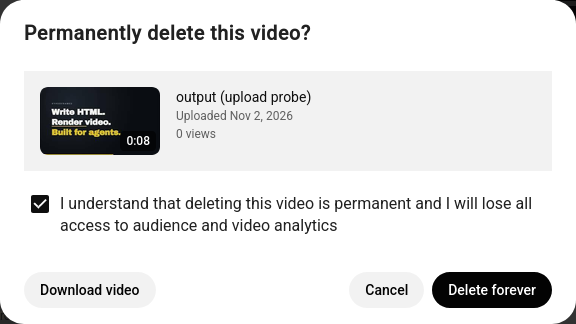

# Studio details panel — `edit_details` / `delete_video`

**PROBED LIVE 2026-11-04** against `https://studio.youtube.com/video/BeCRc-x5B6E/edit` in container
`pachoigame` (`containerId 20`, tab `t_mw1g0lni_6ji`) — the Stage 1 upload, still `Visibility Scheduled`.
Title and description were really edited and saved here. Screenshots in `img/studio-details/`.

`Delete forever` was **not** pressed. Everything up to the enabled button is verified; the final press needs an
explicit go-ahead because it cannot be undone.

---

## 1. Entry

| Fact | Value | Proof |
|---|---|---|
| URL | `https://studio.youtube.com/video/<videoId>/edit` | `navigate` → `status 200`, title `Video details - YouTube Studio`, `containerId 20` |
| Identity on the page | banner heading `Video details`; the video card shows `0:08 output (edited via page flow)` | read after the edit |
| Left nav | `Details` (selected), `Analytics`, `Editor`, `Comments`, `Subtitles`, `Claims`, `Clips & Shorts` | the same list the overflow menu exposes |

The URL takes the **video id**, so Stage 4 needs no content-list scraping to reach a video — which is why
Stage 3 was deferred.

## 2. Selector table — the fields we touch

| Step | Address | Proven value |
|---|---|---|
| Title editor | `div#title-textbox-container > ytcp-social-suggestions-textbox#title-textarea > ytcp-form-input-container#container > div#outer > div#child-input > div#container-content > ytcp-social-suggestion-input#input > div#textbox` | `output (upload probe)`; `contenteditable`; `aria-label="Add a title that describes your video (type @ to mention a channel)"` |
| Short form | `div#title-textbox-container #textbox` | resolved 1 hit |
| Description editor | `ytcp-video-description#description-container > …#description-textarea > … > ytcp-social-suggestion-input#input > div#textbox` | `Probe run for the zen-mcp youtube tool (Stage 1 up…`; `aria-label="Tell viewers about your video (type @ to mention a channel)"` |
| Short form | `#description-container #textbox` | resolved 1 hit |
| **Save** | `ytcp-button#save > ytcp-button-shape > button` (`aria-label="Save"`) | `disabled: false` while dirty → **`disabled: true` after the press** |
| Save confirmation | `[class*='snackbar']` / `ytcp-notification` | **`Changes saved`** |

Write method is the Stage 1 lesson unchanged: `focus()` → `selectNodeContents` → `document.execCommand("insertText")`
→ `input` event. Newlines are fine (`"…(Stage 4 probe).\nSecond line: …"` round-tripped).

### Fields present but not touched by this tool

| Field | Address | Value seen |
|---|---|---|
| Visibility card | `ytcp-video-metadata-visibility` | `Visibility Scheduled` (`schedule-icon`) |
| Audience (COPPA) | `tp-yt-paper-radio-group` | `Yes, it's made for kids . Features like personalized ads and…` |
| Age restriction | `tp-yt-paper-radio-group#age-restriction-group` | `Yes, restrict my video to viewers over 18 / No, don't restrict…` |
| Thumbnail | `#preview-button` × 2 | `Uploaded thumbnail` (showing `Uploading…` at first) and `Auto-generated thumbnail` |
| Advanced settings | `button` `Show more` (`Show advanced settings`) | not opened — unprobed beyond its existence |

## 3. Selector table — delete

| Step | Address | Proof |
|---|---|---|
| Overflow menu | `#overflow-menu-button` (`aria-label="Options"`, `icon="more-vert"`) | press → menu items `Details, Analytics, Editor, Comments, Subtitles, Claims, Clips & Shorts, Download, Delete, Promote, Brainstorm video ideas` |
| Menu item | `tp-yt-paper-item` with exact text `Delete` | press → dialog |
| Dialog | `tp-yt-paper-dialog#dialog` | `Permanently delete this video? 0:08 output (edited via page flow) Uploaded Nov 2, 2026 0 views I understand that deleting this video is permanent and I will lose all access to audience and video analytics Download video Cancel Delete forever` |
| Consent checkbox | `ytcp-checkbox-lit#confirm-checkbox` inside `#dialog-content-confirm-checkboxes > label`; the clickable role node is `div#checkbox[role="checkbox"]`, with a hidden `input` behind it | `aria-checked="false"` |
| Buttons | `Retry` · `Download video` · `Cancel` · **`Delete forever`** | `Delete forever.disabled = true` while unchecked |
| Gate opened | after a **trusted** click on `#confirm-checkbox`: `deleteForeverDisabled: false` |  |
| Abort | `Cancel` | dialog count `1 → 0` |

## 4. Traps

1. **A synthetic click cannot tick the consent checkbox.** `pointerdown/mousedown/pointerup/mouseup/click`
   dispatched from a page program left `input.checked = false` and `Delete forever` disabled; the bridge's own
   `click --selector "#confirm-checkbox"` flipped it. So the flow must press that checkbox through the bridge
   channel, not the page channel — the opposite of what the watch page taught (where the bridge could not see
   the control at all).
2. **`Delete forever` being enabled is the page's proof that consent was registered** — check it, exactly as the
   comment box's `disabled` flip proved the editor write landed.
3. **This page has no `#save-msg`.** The upload wizard's `All changes saved.` indicator does not exist here; the
   signals are the `Changes saved` snackbar and `#save button.disabled: false → true`. A flow that waits for the
   wizard's text on this page waits forever.
4. **Closed dialogs stay in the DOM.** After cancelling, a heading reading `Permanently delete this video?` was
   still reachable by a text search. Every dialog read must filter on `offsetWidth > 0` or the flow will
   "see" a dialog it already closed — and a delete flow that believes a dialog is open is worse than one that
   believes it is closed.
5. **`Save` is a real commit, and unsaved edits are invisible elsewhere.** Title/description changes sit in the
   form until `Save` is pressed; nothing tells the caller they are pending except the button being enabled.
6. **`Uploaded thumbnail` can read `Uploading…`.** Do not treat a transient label as an error state.
7. The delete dialog also offers `Download video` and `Retry` — so matching a button by the *substring* `delet`
   would hit `Download video`/`Delete forever` alike. Match the exact string.

## 5. What the Go flow must do

1. `navigate` to `studio.youtube.com/video/<id>/edit` in the configured container; assert identity from the
   navigate reply, and assert the video card mentions the requested id/title.
2. `edit_details`: write only the fields given (`title` and/or `description`) with the `insertText` path, read
   both back, press `#save button` once, then wait for **both** `Changes saved` and the button becoming
   disabled. Claim the journal slot before `Save` (it is the mutation), bind whatever id the page revealed.
   Never press `Save` twice: a press that is in flight looks the same as one that failed.
3. Refuse a `Save` press when nothing was written — an enabled button is the last signal that anything changed.
4. `delete_video`: require the caller's explicit confirmation parameter, then `#overflow-menu-button` →
   exact-text `Delete` → verify the dialog names the video → press the checkbox **through the bridge channel**
   → verify `Delete forever.disabled == false` → press it once → confirm by observing the page leave the
   details state (dialog gone / redirect), and record the deletion in the journal. Anything short of the
   confirmation parameter stops before the overflow menu.
5. Read dialogs and menus with `offsetWidth > 0`.
6. `--dry_run` stops after reading the fields and the menu structure: it must not press `Save`, must not open
   the delete dialog.

---

## Run of the *flow code* (2026-11-04) — what only the Go path could show

`zyoutube -a edit_details --video_id BeCRc-x5B6E --title … --description …` completed live: wrote both fields,
pressed `Save` once, and the journal recorded it (`slotId s_20261104T100046_7, kind edit, status completed`).
Three things came out of running the code that the hand probe could not show.

1. **`#save`'s display path is not a selector.** §2 records the path as
   `ytcp-button#save > div > ytcp-button-shape > button`. Measured against the live page: every `>`-chain form
   gave **0 hits**, `ytcp-button#save button` gave **1**, and `ytcp-button#save` has **no shadow root** — its
   children are a `dom-if` and a `div`, so the shape is not a child of the host at all. The flow now carries the
   shortest measured-resolving form (§4 trap 8). This is the general lesson: a path a probe prints is a
   description of where a node lives, and only the *scoped* or *descendant* form of it is queryable.
2. **The state probe was being handed the display string as an address**, so it answered "buttons: none" while a
   visible Save button sat there — which turned a save that had really landed into an `ErrTransient`. The probe
   and the press must be given the *same* address, and the summary must say "0 of 4 dialogs shown" rather than
   silently omitting what it could not resolve.
3. **The snackbar is decoration; the flip is the signal.** `Changes saved` lived entirely inside the gap between
   two polls, so requiring both signals reported a successful edit as an unconfirmed commit — the worst possible
   outcome for a flow whose whole job is to say whether the change landed. `#save button` going
   `disabled: false → true` alone now confirms, with the missed snackbar stated as a warning.

### And one bug underneath every page read

`Compose` wrapped each program in `(async () => { … })()` to introduce `args`. The bridge returns what the
program's **own top-level `return`** yields, so that wrapper buried it: every scripted probe came back
`{"success":true,"data":{"logs":[]}}` — no `result` — and `pick`'s "fall back to the whole map" then decoded into
a zero `Finding`, which means *"the page has no such element"* about an element the page is showing. Reproduced
side by side with the same script and the same args: wrapped → no result, statement list →
`{ok:true,count:1,css:"#textbox"}`.

Fixed in two places, because the silent version is the dangerous one:
`Compose` now emits `let args = …;` + the program (no wrapper, first token still a statement keyword), and
`Eval` refuses a reply that carries success but no result instead of handing back an empty Finding.

`Delete forever` has still not been pressed: `delete_video` refuses without `yes_i_understand` before opening a
tab, and with it and `--dry_run` it locates `#overflow-menu-button` and does not press it.
