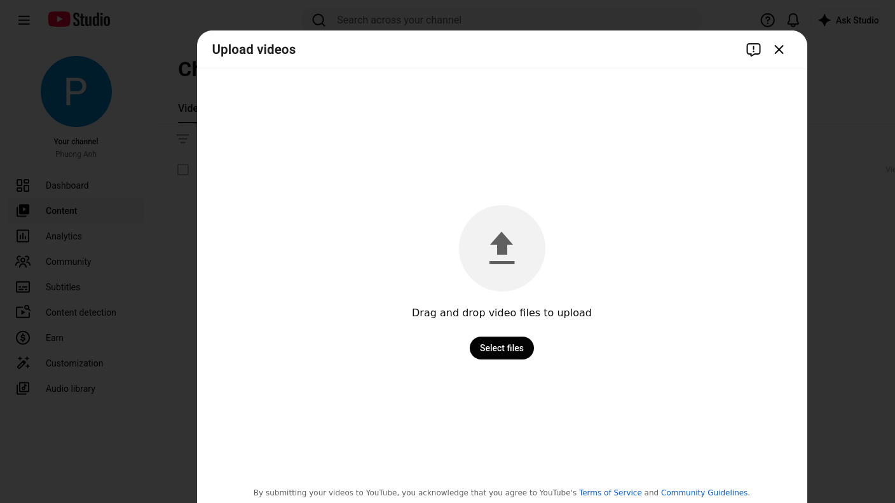
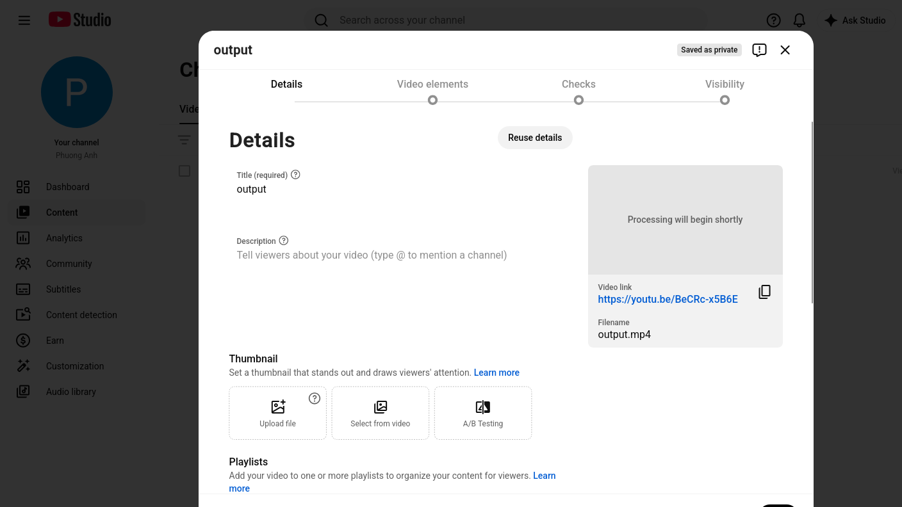
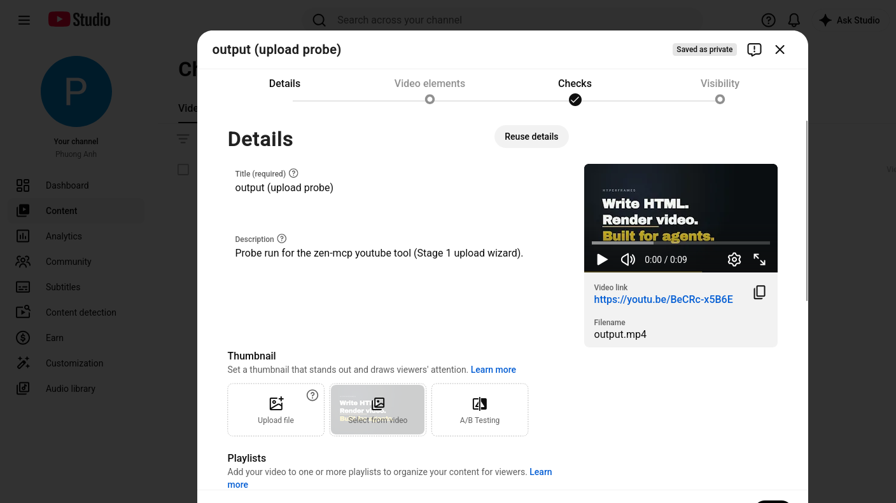
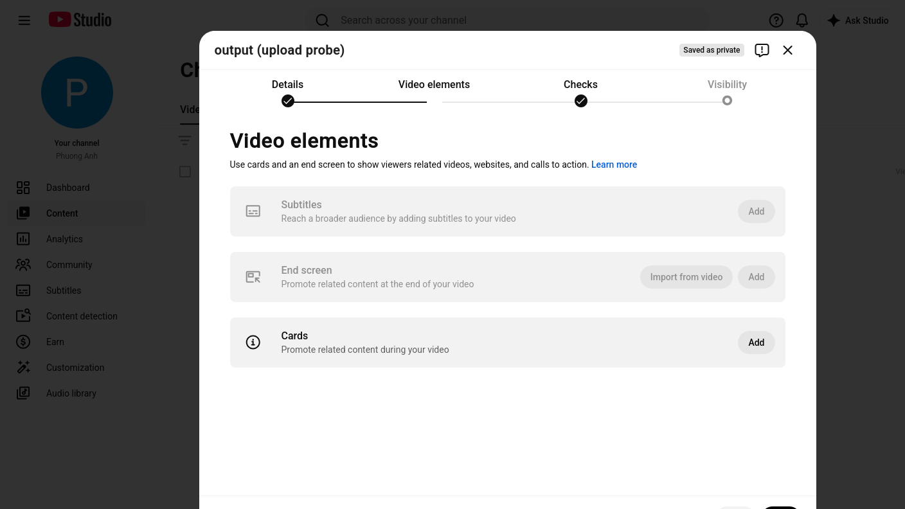
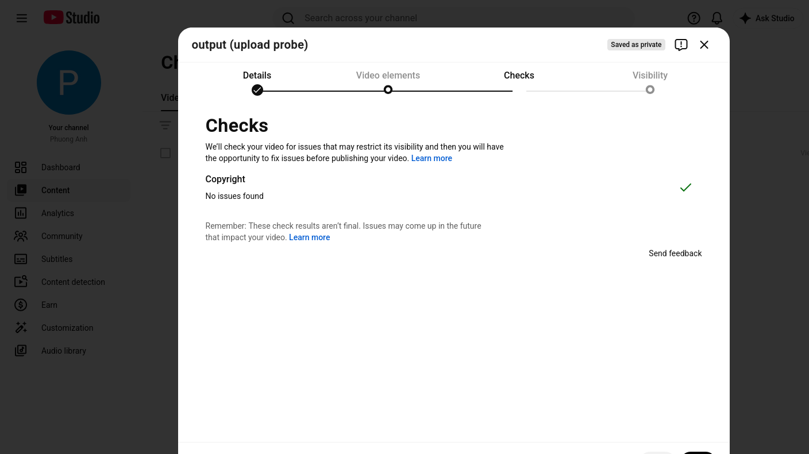
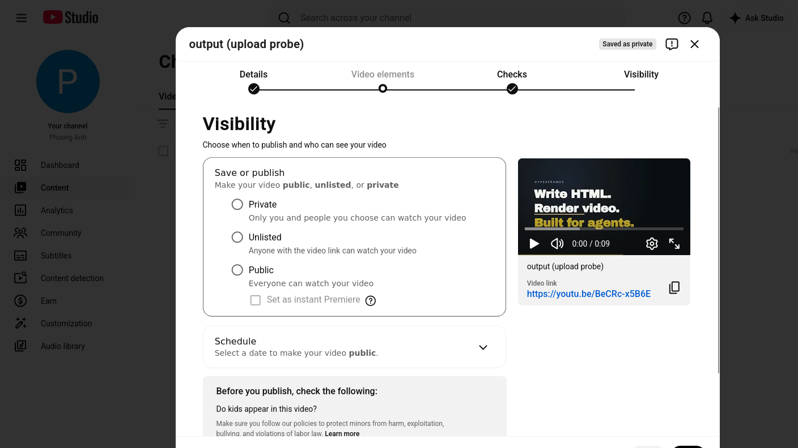
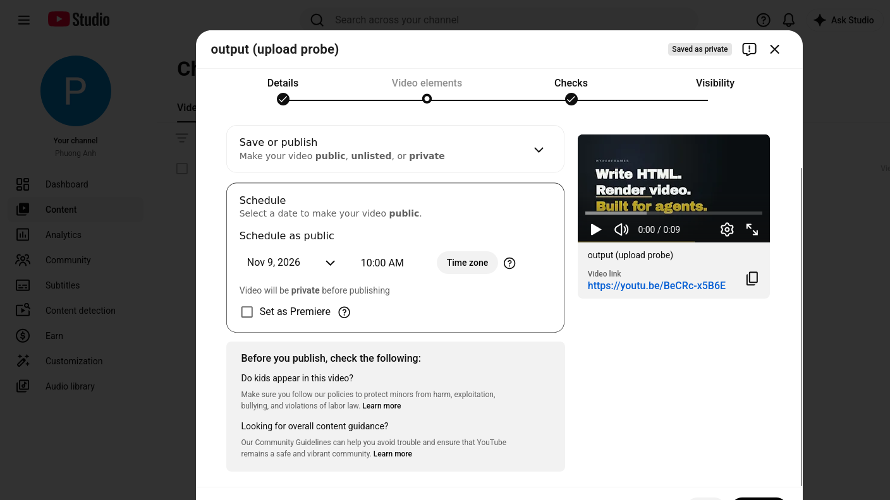
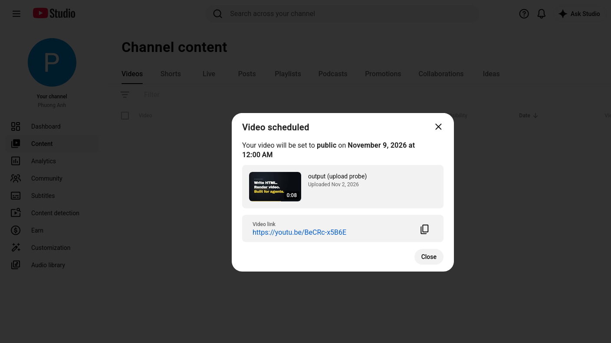

# Upload wizard — live run log (Stage 1, 2026-11-02)

The reconnaissance protocol (§3) executed end to end against the real channel, **one upload, zero
retries**. Every locator below is copied out of a response quoted in this file, and every image was
captured by the bridge's `screenshot` action. This is the evidence base for
`internal/youtube/pages/upload_wizard.go`.

Run facts: container `pachoigame` (`containerId 20`), channel `UCZZei3idefNE6mAUXs2Eh8A`, tab
`t_mvzexmnt_6g5`, file `/media/jang/home/Deve/zen-hyperframes/demo/my-video/output.mp4`
(301 582 B, h264 1920×1080, 8 s).

**Outcome:** video **`BeCRc-x5B6E`** — `https://youtu.be/BeCRc-x5B6E` — title `output (upload probe)`,
scheduled: *"Video scheduled — Your video will be set to public on November 9, 2026 at 12:00 AM"*.

---

## Step 0 — Open the wizard (R1)

```bash
zbrowser -a navigate --url "https://www.youtube.com/upload" --container pachoigame --new_tab true --timeout 60000
```

```json
{"success":true,"id":"t_mvzexmnt_6g5","containerId":20,"status":200,"title":"Channel content - YouTube Studio",
 "url":"https://studio.youtube.com/channel/UCZZei3idefNE6mAUXs2Eh8A/videos/upload?d=ud&filter=%5B%5D&sort=…"}
```

The redirect hands over the channel id, which is what `Page.Open` asserts. Keep `id` and pass it as
`index` on every later call.



## Step 1 — Find the attach target (R4)

`document.querySelectorAll("input[type=file]")` from the page root found **exactly one**, in the light
DOM, hidden (`rect [0,0,0,0]`), `multiple: true`, `accept: ""`, no id and no class — the plan's v1
assumption of a `#files-input` id is wrong:

```
html > body#html-body > ytcp-uploads-dialog > tp-yt-paper-dialog#dialog > div
  > ytcp-uploads-file-picker#ytcp-uploads-dialog-file-picker > div#content > input
```

The visible control beside it: `ytcp-button#select-files-button` → `button[aria-label="Select files"]`,
and the dialog's close control is `ytcp-button#ytcp-uploads-dialog-close-button`.

## Step 2 — Attach the file (one shot, no retry)

```bash
zbrowser --json-file /tmp/yt/upload.json
# {"action":"upload","index":"t_mvzexmnt_6g5",
#  "selector":"ytcp-uploads-file-picker#ytcp-uploads-dialog-file-picker input[type=file]",
#  "path":"/media/jang/home/Deve/zen-hyperframes/demo/my-video/output.mp4"}
```

```json
{"filename":"output.mp4","size":301582,"success":true}
```

`triggerDrop` deliberately omitted (drop + change would attach twice). The dialog closed itself:
a following probe reported `fileInputs: []`.

## Step 3 — Postcondition: the transfer really started (R6)

Read the progress text — **never** `wait_for_network_idle`, which never settles on the Studio SPA:

```json
{"dialog":true,"texts":[
  {"tag":"span","cls":"progress-label style-scope ytcp-video-up…","text":"Upload complete ... Processing will begin shortly"},
  {"tag":"p","cls":"style-scope ytcp-video-upload-progress","text":"Checks will begin when SD processing completes"},
  {"tag":"span","cls":"style-scope ytcp-thumbnail-uploader","text":"Uploading…"}]}
```



The **Details** panel is already on screen at this point, and Studio has *already created the video*:
the card shows `Video link https://youtu.be/BeCRc-x5B6E`, the app bar shows the chip `Saved as private`.
An attach is therefore a channel mutation — the reason this stage is one-shot.

## Step 4 — Details panel locators (R4)

| Control | Locator | Probe evidence |
|---|---|---|
| step tabs | `[role="tab"]` — `Details`, `Video elements`, `Checks`, `Visibility` | `{"t":"Details","s":"true"}` |
| title | `#title-textarea div#textbox` — `div[role=textbox]` **contenteditable**, `aria-label="Add a title that describes your video (type @ to mention a channel)"` | `text: "output"` (prefilled from the filename) |
| description | `#description-textarea div#textbox` — `div[role=textbox]` **contenteditable**, `aria-label="Tell viewers about your video (type @ to mention a channel)"` | `text: ""` |
| thumbnail | `button[aria-label="Upload file"]`, `Select from video`, `A/B Testing` | probe rows at `y=604` |
| made for kids | `ytkc-made-for-kids-select` → `tp-yt-paper-radio-button` ×2: `Yes, it's made for kids …` / `No, it's not made for kids` | `{"c":"false"}` before answering |
| age restriction | `tp-yt-paper-radio-group#age-restriction-group` (default `No, don't restrict…` = `checked:true`) | probe row |
| show more | `button[aria-label="Show advanced settings"]`, text `Show more` | probe row |
| **Next** | `#next-button button` (`aria-label="Next"`, text `Next`) | `disabled:false` |

**No `data-test-id` attributes anywhere in this dialog** — the plan's "Studio ships data-test-id;
prefer them" is false for the upload wizard. Stable `id`s and `aria-label`s are what exist.

### Text entry: `type` does not work here

`zbrowser -a type` on a contenteditable **focused the element and wrote nothing**:

```json
{"el":{"focused":true,"id":"textbox","tag":"DIV","visible":true},"trigger_native_type":{"physX":1014,"physY":717}}
→ read back: {"desc":"","descLen":0}
```

What lands is a DOM-level insert, and Studio's own model takes it — verified by the app bar, not just
by the DOM:

```js
el.focus();
const sel = getSelection(); sel.removeAllRanges();
const range = document.createRange(); range.selectNodeContents(el); sel.addRange(range);   // selectNodeContents ⇒ REPLACE
document.execCommand("insertText", false, text);                                          // fires real input events
```

```json
{"method":"selectNodeContents+insertText","ok":true,"text":"output (upload probe)"}
→ probe: {"save":["saved","Saved as private"],"checks":["Checks complete. No issues found."]}
→ after Next: body text contains "All changes saved."
```

Trap: `sel.selectAllChildren(el); sel.collapseToEnd()` **appends** ("outputoutput (upload probe)").
Use `selectNodeContents` + no collapse to replace.



## Step 5 — The COPPA gate (mandatory field, blocks Next)

Clicking `#next-button button` with the audience question unanswered does **not** advance. The page
shows, in place:

```
"Is this video made for kids? (required)"     ← ytkc-made-for-kids-select
"You need to answer this question"            ← inline error, class style-scope ytkc-made-for-kids-select
```

Answer it, then click Next again:

```bash
zbrowser -a click -i t_mvzexmnt_6g5 --by_text "No, it's not made for kids"
```

```json
{"radios":[{"c":"false","t":"Yes, it's made for kids . Features"},{"c":"true","t":"No, it's not made for kids"}],
 "error":false}
```

A page flow must treat this as a required field, not an error: **every** upload needs an answer, and
`madeForKids` therefore belongs in the tool's parameters.

## Step 6 — Video elements → Checks → Visibility

`#next-button button` again (the id is the same on every panel). Verified by the tab state, which is
the reliable "did the panel change" check — the step headers are not:

```json
Video elements: tabs=[{"t":"Details","s":"false"},{"t":"Video elements","s":"true"},…]  buttons: Back / Next / Save
Checks:       headings: Checks, Copyright · text "Copyright No issues found", "Checks complete."
Visibility:   tabs=[{"t":"Visibility","s":"true"}]
```





## Step 7 — Visibility panel

| Control | Locator | Probe evidence |
|---|---|---|
| instant choices | `tp-yt-paper-radio-group#privacy-radios` with `#private-radio-button`, then `Unlisted`, `Public` | `{"id":"private-radio-button","c":"false"}` |
| instant Premiere | radio `Set as instant Premiere` | group text |
| schedule | radio `Schedule` — `p#visibility-title` holds the label; clicking it selects schedule | panel text after: `Schedule as public` |
| schedule block | `#publish-from-private-non-sponsor` (`.scheduled-info-container style-scope ytcp-visibility-scheduler`), title `#publish-from-private-non-sponsor-title`, editor `#publish-from-private-non-sponsor-selector` | probe rows |
| date | `ytcp-text-dropdown-trigger#datepicker-trigger` (text `Nov 3, 2026`) | `{"dateTrigger":"Nov 3, 2026"}` |
| time | `ytcp-datetime-picker input.style-scope.tp-yt-paper-input` (value `12:00 AM` — U+202F before `AM`, code 8239) | `{"timeValue":"12:00 AM"}` |
| timezone | `button` text `Time zone`; note `Video will be private before publishing` | panel text |
| premiere opt-in | `div[role=checkbox]` text `Set as Premiere` | probe row |
| commit | `#done-button button` — **label is contextual: `Publish` / `Save` / `Schedule`** | `done-button  Schedule  disabled:false` |

## Step 8 — Setting the date: the text field is a lie, the calendar is real

Clicking `#datepicker-trigger` opens a **modal virtualised calendar** —
`ytcp-date-picker > tp-yt-paper-dialog#dialog > ytcp-scrollable-calendar#calendar > tp-yt-iron-list#calendar-main`
— which also contains a text input `ytcp-date-picker input.style-scope.tp-yt-paper-input` showing
`Nov 3, 2026`.

**Writing that input never commits.** Five methods, all reverted on close:

| Attempt | Result |
|---|---|
| `zbrowser -a type --text "Nov 9, 2026"` | input shows the text, `#datepicker-trigger` stays `Nov 3, 2026` |
| native value setter + `input` + `change` + `blur` | reverted |
| synthesized `keydown`/`keyup` Enter | reverted |
| `form#form` `submit` / `requestSubmit()` | input reset to `Nov 3, 2026` |
| `-a key_combo --combo Return` (xdotool) | never delivered — OS focus, and the tab was in the background |

What works is a **DOM-level click on the day cell** — no `trusted_*`, no focus steal:

```js
// span.calendar-day inside the NOV 2026 group; classes: "disabled" (past), "today", "selected"
cell.click();     // cell chosen by day number AND by its month group (112 cells are rendered)
```

```json
{"ok":true,"x":441,"y":564,"cls":"calendar-day"}
→ {"dateTrigger":"Nov 9, 2026"}          ← the model took it
```

The same applies to **time**: `-a type` on `ytcp-datetime-picker input` displayed `10:00 AM` and the
screenshot shows it, but the committed value stayed `12:00 AM` — proven by the final page text below.
So the time must be set through the picker's own option list, or by a real keystroke
(`native_type`/`human_type`, which steal focus and need a human's OK).



## Step 9 — Commit

```bash
zbrowser -a click -i t_mvzexmnt_6g5 --selector "#done-button button"     # label was "Schedule"
```

Share dialog (`.ytcp-video-share-dialog`), read verbatim:

```
"Video scheduled Your video will be set to public on November 9, 2026 at 12:00 AM
 0:08 output (upload probe) Uploaded Nov 2, 2026 Video link https://youtu.be/BeCRc-x5B6E
 Close Link copied to clipboard"
```



The `Close` control was **not** probed (per instruction); the tab was left as-is.

---

## What the Go flow must do

1. `navigate youtube.com/upload` in the configured container → assert `containerId` + channel id from
   the redirected URL.
2. `upload` to `ytcp-uploads-file-picker#ytcp-uploads-dialog-file-picker input[type=file]`, no `triggerDrop`.
3. Poll the progress text; treat "Upload complete"/`%` as the attach postcondition. **The video exists
   from here on** — this is why the journal claims a slot *before* this call.
4. Details: `madeForKids` is mandatory; title/description via `selectNodeContents` + `execCommand("insertText")`,
   each verified by read-back **and** by the `All changes saved.` / `Saved as …` affordance.
5. `#next-button button` → verify by `[role=tab][aria-selected=true]`, not by header text.
6. Visibility: byText on `Private`/`Unlisted`/`Public` (cheap and reliable), or `Schedule` + the
   **calendar**, computing the day cell from `publish_at` (month group + day number, skipping
   `.disabled`).
7. Time through the picker's list, never by writing the input; until that is probed, `publish_at`
   accepts the date only and reports the time as `unverified`.
8. Commit with `#done-button`, whose label says `Publish`/`Save`/`Schedule`, then read the video id out
   of `.ytcp-video-share-dialog` text (`https://youtu.be/<id>`) and assert it against the page URL.

## Probe-channel notes (bridge behaviour learned the hard way)

* `screenshot`/`web_eval`/`click`/`type`/`close_tab` are index-addressed and work on a background tab;
  `screenshot` needs an **absolute** `path` (a relative one returns `success:true, data:null` and writes
  nothing).
* `web_eval` has **no `args` param** — inline the data into the program.
* A program's first token must be `return|var|let|const` (the prelude in `page.go` guarantees it).
* `click`/`type` report `trigger_native_click`/`trigger_native_type` with screen coordinates — the
  bridge's own note that its DOM-level attempt was weak, which is exactly when a flow should verify
  instead of assuming.
* `key_combo` is OS-level: it needs the real cursor, so it is useless on a background tab.
* `get_interactive_map` still replies `data:null`; the R4 walker in `web_eval` is the probe channel.
