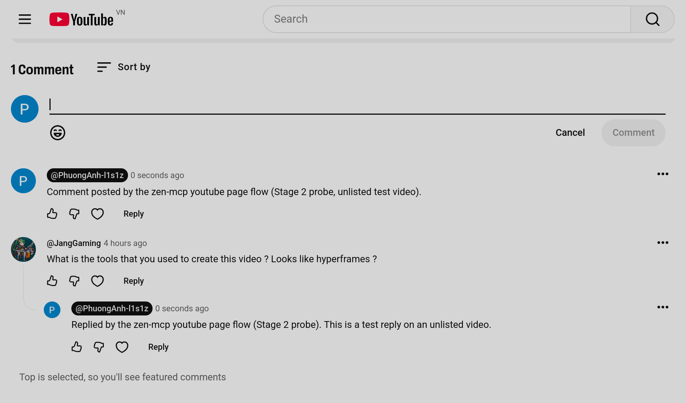
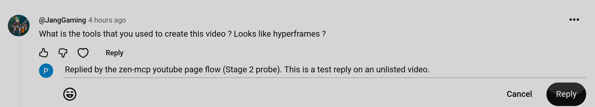
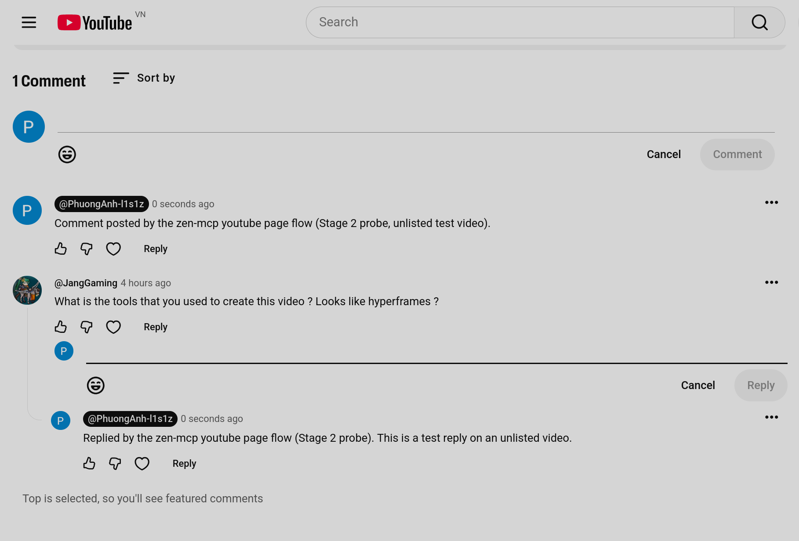

# Watch page — read, comment, reply

**Probed live 2026-11-03** on `https://www.youtube.com/watch?app=desktop&v=YSNFGgh0aAs` in container
`pachoigame` (`containerId 20`, tab `t_mw0cz7t1_6hh`), one seeded comment by `@JangGaming`. Screenshots in
`img/watch/`.

The submission click itself was **not** fired: the page belongs to another channel, so posting there is a
public act on a third party. Everything up to and including the enabled submit button is verified; the
read-back after posting is marked *unverified* below and needs one run on a video of our own.

---

## 1. Structure

| Element | Selector / address | Proven value |
|---|---|---|
| Section | `ytd-comments#comments` → `ytd-item-section-renderer#sections` | text `1 Comment Sort by …` |
| Header | `ytd-comments-header-renderer` | `1 Comment`, `Sort by` (`tp-yt-paper-button[aria-label="Sort comments"]`) |
| Thread | `ytd-comment-thread-renderer` (one per comment) | 1 found |
| Row | inside thread: `#comment-container` → `ytd-comment-view-model#comment` → `#body` | children `#author-thumbnail`, `#main`, `#action-menu` |
| Author | `#body > #main > #header > #header-author > h3 > a#author-text` | `@JangGaming` |
| Published | `… #header-author > span#published-time-text` (contains an `<a>`) | `4 hours ago`; the `<a>` carries `title` with the absolute time |
| **Comment id** | that `<a>`'s `href` → `?v=<video>&lc=<id>` | `UgwEFzl5ZWYy-wHKInF4AaABAg` |
| Text | `#main > ytd-expander#expander > #content > yt-attributed-string#content-text` | `What is the tools that you used to create this video ? Looks like hyperframes ?` |
| Replies | `#body` sibling `#replies` inside the thread | empty when there are none |
| Row toolbar | `#main > ytd-comment-engagement-bar#action-buttons > #toolbar` | Like / Dislike / heart / `Reply` |
| Reply button | `ytd-button-renderer#reply-button-end > yt-button-shape > button[aria-label="Reply"]` | pressed, opened the reply box |

Everything is light DOM with stable ids — no shadow walking needed to *read* a row, unlike Studio.

**The id is in the page, not an API.** `… &lc=` is YouTube's own comment id (the `lc` link param), so `read`
can return an id that `comment_id` accepts later, with no network call.

## 2. Comment box

| State | Selector | Notes |
|---|---|---|
| Closed trigger | `ytd-comment-simplebox-renderer#simple-box > #placeholder-area > yt-formatted-string#simplebox-placeholder` | `role="textbox"`, text `Add a comment...` — **click it**; the editor does not exist in the DOM until you do |
| Opened box | `#simple-box > #comment-dialog > ytd-comment-dialog-renderer > ytd-commentbox#commentbox` | replaces the placeholder in place |
| Editor | `#labelAndInputContainer > div > ytd-emoji-input#emoji > yt-user-mention-autosuggest-input > yt-formatted-string#contenteditable-textarea > div#contenteditable-root` | `contenteditable`, `aria-label="Add a comment..."` |
| Submit | `ytd-commentbox#commentbox … #footer > #buttons > ytd-button-renderer#submit-button > yt-button-shape > button` | `aria-label="Comment"`, **`disabled` until text lands** |
| Cancel | `… ytd-button-renderer#cancel-button > yt-button-shape > button[aria-label="Cancel"]` | |
| Emoji | `#footer > span#emoji-button … button[aria-label="Show emoji picker"]` | do not click: it opens a popover over the editor |

 · 

## 3. Reply box

Pressing a row's `Reply` opens a second, nested box — **both boxes can be open at once**, so a flow must
scope by ancestor and never take "the first `#commentbox`":

```
ytd-comment-thread-renderer > #comment-container > ytd-comment-view-model#comment > #body > #main
  > ytd-comment-engagement-bar#action-buttons > #reply-dialog
    > ytd-comment-reply-dialog-renderer#replybox > ytd-commentbox#commentbox
```

Inside it the same parts as the top-level box, with the submit labelled **`Reply`** (not `Comment`) and
likewise `disabled` until text lands:
`#replybox … ytd-button-renderer#submit-button button[aria-label="Reply"]`.


## 4. Traps

1. **`querySelector` inside a row picks the wrong element.** `#published-time-text a, #published-time-text`
   returns the *span* (document order), so the `lc` id vanishes. Ask for the anchor first, or search the row's
   subtree for `a[href*="lc="]`.
2. **A composite selector written without commas is a descendant chain.** `#a #b` means "`#b` inside `#a`" —
   probing `"ytd-comments ytd-item-section-renderer …"` returns nothing and looks like a missing feature.
3. **`document.execCommand("insertText")` is what commits the editor** (same as Studio): `ed.textContent = …`
   leaves the Angular model empty and the submit button stays disabled. Verified: after `insertText` the
   editor read back the text and `#submit-button button.disabled` flipped `true → false`.
4. **The box does not exist until the placeholder is clicked**, and the placeholder is a `yt-formatted-string`,
   not a button.
5. **A synthetic press did not close a box.** Pressing `#cancel-button` through the page channel (and through
   the bridge's locator click) left both boxes open — YouTube listens for its own host-level handler. Harmless
   for the flow (cancel is not a step we need), but do not rely on it to clean up: close the tab instead.
6. **Comments are lazy-rendered.** Nothing under `#comments` exists until the section has been scrolled into
   view; `read` must scroll and wait, exactly like the Studio list.
7. *Unverified:* the appearance of the posted comment, its ordering under `Sort by: Top`, and the "comment
   posted" acknowledgement. The flow therefore confirms a post by **re-reading the thread for the new text or
   id**, and reports `pageVerified: false` if the read-back does not find it.

## 5. What the Go flow must do

1. `navigate` to `https://www.youtube.com/watch?v=<id>` in the configured container; assert identity.
2. Scroll `#comments` into view (`#comments` → `ytd-comments#comments`), wait for `ytd-comment-thread-renderer`
   or the header; `read` walks threads with the table above, returning author / text / relative and absolute
   time / `lc` id, and follows `#replies` for the reply rows.
3. `comment`: click `#simplebox-placeholder`, wait for `#commentbox`, `execCommand("insertText")` into
   `#contenteditable-root`, **verify the submit button became enabled**, then press
   `ytd-button-renderer#submit-button button` — after claiming a journal slot.
4. `reply`: same, scoped under `#replybox`, opened by that row's `#reply-button-end button`; the row is
   addressed by the `comment_id`'s `lc` link so the wrong comment is never answered.
5. Confirm by re-reading: the new text (or id) must appear in the thread; otherwise `ErrTransient` with the
   trail — the post may or may not have happened, so the flow must never press submit again.
6. `--dry_run` stops before writing; the submit button is never touched.
